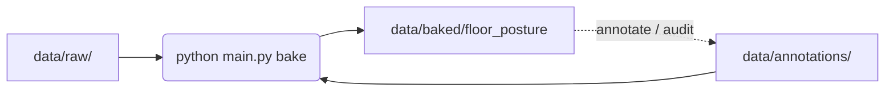
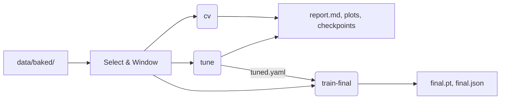

# AI Engineering Practical — Valtes

Contactless floor-posture recognition from mmWave radar data. The default task predicts whether lying occurred within a 3.2-second sliding window of radar frames (16 frames at ~0.2 s per frame). Every evaluation split is grouped strictly by participant so no person ever appears in both training and test sets.

## Setup

Requires Python 3.12+, `uv`, and `git-lfs` (`apt install git-lfs` or `brew install git-lfs`).

```bash
git lfs install && git lfs pull
uv sync
source .venv/bin/activate
uv pip install -e ./data/raw/floor_posture_dataset/recorder
```

Optional Jupyter kernel for notebooks under `notebooks/`:

```bash
uv pip install -e ".[jupyter]"
python -m ipykernel install --user --name floor-posture
```

Verify the environment with the test suite and type checker (the flag is required because `vt_radar` ships without type stubs):

```bash
uv run pytest
uv run mypy main.py --ignore-missing-imports
```

## Data and Annotation Workflow



Data is separated into three directories:

- `data/raw/` — raw radar and camera recordings tracked in Git LFS.
- `data/annotations/` — hand-made CSV labels tracked as normal Git text files (`person_map.csv`, `presence_events.csv`, `lying_intervals.csv`).
- `data/baked/` — generated Hugging Face Arrow dataset (`data/baked/floor_posture`, gitignored, ~4.4 GB).

**Build the baked dataset before running any other command:**

```bash
# Full build from raw recordings (~20 s with 6 workers)
python main.py bake --num-proc 6 --overwrite

# Re-join updated CSVs in data/annotations/ without re-reading raw .h5 files
python main.py bake --refresh-annotations
```

Unreviewed recordings remain on disk with `lying_annotation = None` and are only skipped in memory when building windows. Note that the baked dataset contains identifiable camera feeds; keep `data/baked/` and any exported viewers local.

To review camera video in capture order, mark lying intervals, and compare them against the original `label_pose` track:

```bash
# Open the local annotation UI (edits save directly to data/annotations/lying_intervals.csv)
python main.py annotate --port 8765

# Push edited annotations into the baked dataset
python main.py bake --refresh-annotations

# Write an interval, frame, and window agreement report with deep links back into the UI
python main.py audit --out results/annotation_agreement.md
```

For baking schema details and radar pitfalls, see [docs/data_notes/baked-dataset.md](docs/data_notes/baked-dataset.md) and [src/data/README.md](src/data/README.md). For keyboard controls and `--lan` usage, see [src/annotation_tool/README.md](src/annotation_tool/README.md).

## CLI Commands

Every workflow runs through `main.py`. Pass `--help` after any subcommand for its flags.

| Command                             | Purpose                                                                                                                                                           |
| ----------------------------------- | ----------------------------------------------------------------------------------------------------------------------------------------------------------------- |
| `python main.py bake`             | Build `data/baked/floor_posture` from raw recordings (`--num-proc`, `--overwrite`, `--recording`) or update annotations only (`--refresh-annotations`). |
| `python main.py annotate`         | Launch the local camera-video lying annotation server (`--port`, `--csv`, `--lan`, `--no-browser`).                                                       |
| `python main.py audit`            | Compare reviewed lying annotations against raw `label_pose` (`--csv`, `--out`, `--port`).                                                                 |
| `python main.py cv`               | Run person-grouped cross-validation and write metrics, loss curves, checkpoints, and `report.md`.                                                               |
| `python main.py tune`             | Run nested leave-one-person-out hyperparameter search over `tune.grid` and save the overall winner to `results/tuned.yaml`.                                   |
| `python main.py train-final`      | Train one deployment model on all available participants using `results/tuned.yaml` and save `final.pt`.                                                      |
| `python main.py report <run_dir>` | Rebuild `report.md` and loss-curve figures from an existing `results.json`.                                                                                   |

## Configuration and Label Rules

Defaults live in three YAML files under `config/` and can be overridden on the command line using dotted `key=value` syntax. Unknown keys and invalid combinations are rejected immediately.

- `config/data.yaml` — paths, recording selection (`Config_4.cfg`, excluded non-top-down recordings; unknown participants are always dropped), optional heatmap denoising, and windowing rules. Loaded by `bake`, `annotate`, `audit`, and all training commands.
- `config/train.yaml` — active `model`, `seed`, `out_dir`, optimiser/loop hyperparameters (`training.*`), `cv.*`, and `tune.*`.
- `config/models/<name>.yaml` — architecture (`model.arch.*`) and training-only batch augmentation (`model.augment.*`) for the active model only. Switch models with `model=<name>` (not `model.name=<name>`).

### Windowing and Label Rules

Frames are filtered to valid labelled Config 4 frames, ordered by capture timestamp, and sliced into windows of `windowing.window_len` frames (default `16`, ~3.2 s) stepped by `windowing.stride` (default `8`, ~1.6 s). Windows spanning dropped frames are skipped.

- `windowing.target` (default `lying_annotation`): selects the per-frame ground-truth column (`lying_annotation` = hand-reviewed binary labels; `label_pose` = original pose track).
- `windowing.label_rule` (default `any_lying`): determines how 16 frame labels collapse to 1 window label.
  - `any_lying` marks a window lying if **at least one** frame in the window is lying (designed so brief lying episodes are not missed).
  - `last` uses only the label of the final frame in the window.
- `windowing.collapse_lying` (default `true`): merges all `lying*` labels into `lying` and all other labelled poses into `not_lying`.

### Optional Controls (Off by Default)

- **Heatmap denoising** (`denoising.range_normalise.enabled`, `denoising.temporal_background.enabled`): per-recording signal filters applied identically to all splits before windowing.
- **Training-only batch augmentation** (`model.augment.*`): light input noise (`RNN`) and `point_drop`/`jitter` (`PointNet`) are active by default; geometric transforms (`range_shift_bins`, `floor_jitter`, `time_reverse`, `shift_m`, `height_m`, `yaw_deg`, `tilt_deg`, `mirror`, `ghost_points`, `snr_jitter_db`) default to off.
- **Class imbalance** (`training.class_weights=true`, `training.oversample_ratio=null`): training loss uses inverse-frequency class weights by default; oversampling minority training windows is off by default. Validation loss is always class-balanced.

See [config/README.md](config/README.md) for the complete parameter reference and cross-field validation rules.

## Models and Checkpoints

| `model`         | Input per Window                                                          | Architecture                                                      |
| ----------------- | ------------------------------------------------------------------------- | ----------------------------------------------------------------- |
| `rnn` (default) | `log1p` range-Doppler heatmaps `(T, 1, 256, 16)`                      | 3-block per-frame 2D CNN + GRU (~131k params)                     |
| `pointnet`      | Pooled radar points `(128, 7)` (`x, y, z, doppler, snr, time, valid`) | Shared per-point MLP + masked max/mean pool + count (~27k params) |
| `baseline`      | None                                                                      | Predicts the most frequent training class                         |

Every fold checkpoint and `final.pt` stores weights, input standardisation statistics, class names, architecture kwargs, and the windowing signature (`{target, collapse_lying, window_len, label_rule, max_points}`). Load any saved model with:

```python
from models.model import BaseModel

model, windowing = BaseModel.load("results/<run>/checkpoints/fold1_Bob.pt")
predictions = model.predict(x_test)
```

For layer details and steps to add a new model, see [src/models/README.md](src/models/README.md).

## Running Experiments, Tuning, and Final Training



### 1. Cross-Validation (`cv`)

By default (`cv.folds=null`), each outer fold holds out one participant for testing and one training participant (`training.validation=true`) for early stopping on class-balanced validation loss:

```bash
python main.py cv model=baseline cv.folds=2
python main.py cv model=pointnet training.epochs=15 model.augment.shift_m=0.3
python main.py cv training.validation=false training.epochs=5
```

### 2. Nested Tuning and Final Model (`tune` then `train-final`)

To select hyperparameters without touching the test participant, run nested leave-one-person-out tuning first, then train the final deployment model on all participants:

```bash
# 1. Nested LOPO tuning (write a space after each colon inside tune.grid)
python main.py tune 'tune.grid=[{model.arch.hidden: 64}, {model.arch.hidden: 128, training.lr: 0.0003}]'

# 2. Train one final model on all people using results/tuned.yaml -> results/<run>_final/final.pt
python main.py train-final
```

1. Each outer fold holds out one participant for testing.
2. Inside the outer training fold, every candidate in `tune.grid` is evaluated by inner leave-one-person-out using pooled outer-training class weights so validation losses across inner people stay on one scale.
3. The lowest mean validation-loss candidate is refit on all outer training participants for its median best epoch count and scored on the untouched test participant.
4. Across outer folds, the candidate with the most outer wins (tie-break: lowest mean winning validation loss) is written to `results/tuned.yaml` along with its model name and windowing signature. `train-final` refuses to run if the current model or windowing settings do not match.

### Run Outputs

Each `cv` or `tune` run writes `results/<YYYYMMDD-HHMMSS>_<model>/`:

- `report.md` — settings, frame/window coverage funnel, pooled headline metrics, tuning tables (if tuned), per-fold and per-person tables, curves, and checkpoint paths.
- `results.json` — full typed run record including per-step loss histories.
- `loss_per_fold.png` and `loss_mean.png` — per-fold and cross-fold loss curves (iterative models only).
- `checkpoints/fold<k>_<person>.pt` — best weights for each outer fold (plus `tuned.yaml` on `tune` runs).

Rebuild any run's report and plots with `python main.py report results/<run>`. For equations, splitting mechanics, and small-cohort caveats, see [src/training/README.md](src/training/README.md), [src/evaluation/README.md](src/evaluation/README.md), and [docs/modeling.md](docs/modeling.md).

## Running on the Remote GPU PC

GPU training runs on `haukurs_pc` (Windows + WSL2 + RTX 3070 over Tailscale) via wrapper scripts in `scripts/remote_pc/`. Override target host or path with `PC_HOST` and `PC_DIR`.

```bash
# One-time setup
scripts/remote_pc/push-code.sh
scripts/remote_pc/setup.sh
scripts/remote_pc/push-data.sh

# Typical run cycle
scripts/remote_pc/push-code.sh
scripts/remote_pc/train.sh tune 'tune.grid=[{model.arch.hidden: 64}, {model.arch.hidden: 128, training.lr: 0.0003}]'
scripts/remote_pc/logs.sh -f
scripts/remote_pc/fetch-results.sh
```

Use `status.sh` to check GPU/job state and `stop.sh` to terminate running jobs. Because WSL shuts down ~15 seconds after the last SSH session closes, `train.sh` and `job.sh` hold a local SSH keeper open for the duration of the job — **keep your local machine awake and Tailscale connected until the job finishes**. Full script reference: [scripts/remote_pc/README.md](scripts/remote_pc/README.md).

## Repository Layout

```text
main.py                 CLI entry point (bake, annotate, audit, cv, tune, train-final, report)
config/                 YAML defaults (data.yaml, train.yaml, models/<name>.yaml) -> config/README.md
data/                   raw/ (Git LFS), annotations/ (tracked CSVs), baked/ (gitignored)
src/
  config/               Typed config dataclasses, YAML/CLI loaders, and cross-field validation
  data/                 Baking, annotations, preprocessing, windowing, augmentation, resampling
  models/               RNN, PointNet, baseline, checkpoints, and factory
  training/             Fitting engine, person-grouped splitting, CV, nested tuning, and pipelines
  evaluation/           Metrics, results.json schema, loss plots, report builder, annotation audit
  annotation_tool/      Local web UI for marking lying intervals from camera frames
scripts/                remote_pc/ (GPU runner scripts), viewer/ (Config 4 HTML viewer), archive/
notebooks/              exploration/, labelling/, archive/
docs/                   modeling.md, data_notes/, dev_notes/, report/, slides/
results/                Per-run outputs (gitignored)
tests/                  Pytest suite mirroring src/
```
