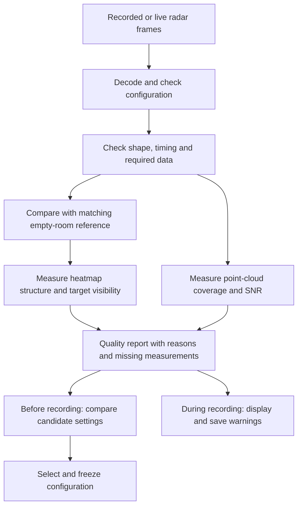

# Energy functions for radar recording quality: research and implementation guide

**Purpose:** explain what we should measure, why it might help, and exactly what each implementation step should take in and produce.

**Project:** TI IWR6843AOP radar, range-Doppler heatmaps, point clouds, and the floor-posture classifiers in this repository.

**Status:** research and proposed implementation, reviewed against the repository on 27 November 2026. The quality module, calibration command, quality logs, and automatic controller below are proposed additions. They have not been implemented or tested on hardware as part of this work.

## 1. What problem are we trying to solve?

We want to know whether a radar recording contains useful information about a person, especially a person lying still on the floor. We also want to know what an operator should change when the recording is poor.

A bright heatmap is not enough. A metal object can produce a strong reflection while the person remains difficult to see. A large point cloud is not enough either: lowering the detection threshold can produce extra points from noise. Conversely, a frame with no detected points can be normal when the room is empty.

Our quality assessment therefore needs to answer separate questions:

1. Did we receive complete, correctly interpreted radar data?
2. Does a person produce a measurable change from the empty room?
3. Does the heatmap contain useful structure rather than only background or isolated interference?
4. Does the point cloud contain enough plausible detections for PointNet?
5. Is there evidence of receiver saturation, recording problems, or changing background conditions?

An **energy function** converts measurements into a penalty. A larger penalty means a worse result. A window with many missing frames should receive a large penalty for missing data; a complete window should receive none for that issue.

Here, “energy” means **a mathematical cost to minimise**. It does not measure electrical consumption or transmitted radar power. It is also separate from the loss used to train the posture classifier.

### Two uses, with different inputs and outputs

| Use | Input | Output | What happens next? |
| --- | --- | --- | --- |
| Assess a recording | Radar frames, configuration, optional empty-room reference, and known or unknown occupancy | Measurements, validity flags, separate heatmap and point-cloud scores, and explanations | An operator reviews the result; later, validated rules can flag model windows |
| Choose a radar setting | Allowed configurations, calibration recordings made under each setting, and their quality reports | Comparison table and recommended configuration, or a report that none passed | Apply the selected configuration before recording and keep it fixed |

The scorer measures quality. The tuner chooses settings using those measurements. Keeping those responsibilities separate lets us test the scorer on existing recordings before it influences the sensor.

### Before recording and during recording

Before recording, compare settings using repeatable empty-room and occupied tests. During a recording intended for the training dataset, keep the radar configuration fixed and monitor quality.

Changing gain, clutter removal, detection thresholds, or the mounting changes the data distribution. Even with the same heatmap dimensions, the model input can change. A later deployment experiment may investigate runtime CFAR changes, but the first implementation should only measure and report.



## 2. What we actually have in this repository

These facts determine which parts we can implement offline and which need new collection or firmware investigation.

| Existing component | What it provides | Consequence for implementation |
| --- | --- | --- |
| [Baking code](../src/data/bake.py) | One row per frame, including `heatmap`, `heatmap_ok`, `pointcloud`, `timestamp`, `radar_frame_num`, `frame_idx`, and `radar_payload` | Start with baked data. Raw bytes remain available for packet checks |
| [Data configuration](../config/data.yaml) | `window_len: 16`, `stride: 8`, `max_points: 128`, and recording selection | Read these values rather than hard-coding them in quality functions |
| [Window construction](../src/data/windowing.py) | Heatmaps become `float32`, pass through `log1p`, and enter windows; point windows keep the strongest 128 points by SNR when needed | Measure raw heatmaps before the model transform, and count points before truncation |
| [Annotation helpers](../src/data/annotations.py) | `capture_positions` reconstructs capture order; `person_present` and `lying_annotation` have different meanings | Use capture order and occupancy labels only where known |
| [Recorder](../src/vt_radar/recording_utils/recorder.py) | Raw packets and optional camera images written in HDF5 chunks, with a configuration copy | Add quality outputs alongside recordings after offline validation |
| [Frame parser](../src/vt_radar/parsing_utils/parseFrame.py) | Heatmap, point-cloud, statistics, and temperature dispatch; the noise-profile branch logs and skips its payload | Noise-profile scoring needs parser work. Expose optional telemetry to the scorer |
| [TLV parsers](../src/vt_radar/parsing_utils/parseTLVs.py) | Heatmap cells are read as `uint16`; ordinary point side information is multiplied by `0.1` | Ordinary decoded point SNR is already in dB. Do not scale it by `0.1` again |

Some configuration and parser files in this checkout are Git LFS pointer files. Their locally available LFS object contents were inspected for this review. Before implementing or importing those modules, ensure the working files contain the real source rather than the three-line pointer. That is a checkout prerequisite, separate from the quality algorithm.

### Existing observations that motivate the work

[The modeling notes](modeling.md) report a median of two detected points per frame and 27% empty frames among the labelled frames they analysed. They also report about 41 points per 16-frame window and truncation in only 0.3% of windows at the current 128-point limit. These are existing documented observations, not measurements rerun for this document. The first offline analysis should reproduce them on its explicitly selected dataset.

The [cohort notes](data_notes/floor-posture-cohorts.md) describe ten removed recordings whose configuration disabled point-cloud output, and retained cohorts with different grids and physical scales. They warn that the same configuration filename can refer to different contents.

Compare **configuration contents and derived physical parameters**; `Config_4.cfg` alone is not a sufficient identity check. For example, the bundled `config/radar/Config_4.cfg` contains `clutterRemoval -1 0`, whereas the historical cohort table describes other recordings with clutter removal enabled. Inspect the copy stored with each recording.

The baked schema stores `range_resolution_m`, but has no dedicated `bin_spacing_m` column or configuration hash. Obtain those from the original configuration for the quality context. Do not silently treat physical resolution as bin spacing.

### Terms used below

| Term | Plain-English meaning |
| --- | --- |
| Frame | One radar measurement/update, containing several kinds of output |
| Packet / TLV | A packet carries one frame. A TLV is a typed section inside it, such as points, heatmap, or temperature |
| Firmware / SDK | Firmware is the software running on the radar; the SDK provides code and documentation for building it |
| FFT | A calculation that converts sampled signals into frequency bins, used to estimate range and radial velocity |
| CFAR | Constant false-alarm rate detection: compare a cell with an estimated local background and keep sufficiently strong detections |
| SNR / SCNR | Signal-to-noise ratio / signal-to-clutter-and-noise ratio. These need defined signal and noise quantities; arbitrary heatmap values do not automatically supply them |
| Clutter | Reflections from the room and other objects that are unwanted for the current task |
| ADC | The analogue-to-digital converter, which turns receiver voltages into numbers; a later heatmap is not its raw output |
| Saturation / clipping | A stage cannot represent a larger input correctly, so information can be lost |
| Baseline / reference | A measurement of the room under known conditions, used to interpret subsequent changes |
| Penalty / weight | A penalty expresses one problem numerically; a weight controls its contribution to a combined penalty |

## 3. Understand the input before choosing a formula

### 3.1 One range-Doppler heatmap

A heatmap is a two-dimensional array:

```text
I.shape = (R, D)
R = number of range bins
D = number of Doppler bins
```

For the current model shape, `R = 256` and `D = 16`: 4,096 cells per frame.

- A **range bin** represents a distance interval from the sensor.
- A **Doppler bin** represents a radial velocity interval: motion towards or away from the sensor.
- A **cell value** comes from the firmware's detection matrix. A larger value means a stronger response under that firmware's encoding.

A heatmap does not directly give a person's full three-dimensional location or posture. Two objects at the same range and radial velocity can contribute to the same cell.

The baked heatmap has zero radial velocity at Doppler bin `0`. `fftshift` centres zero velocity for a plot. Pick one convention for scoring and store it in metadata; using a shifted mask on an unshifted map selects the wrong velocities.

**Unit rule:** storing a value as `uint16` does not establish that it is linear physical power. Verify the detection-matrix representation in the firmware actually used. Until then, use names such as `raw_excess` and `standardised_change`. Do not report physical SNR or SCNR in dB from arbitrary raw heatmap ratios. TI documents the packet layout; check application processing against the matching demo. [TI UART format](https://dev.ti.com/tirex/explore/content/radar_toolbox_2_20_00_05/docs/software_guides/Understanding_UART_Data_Output_Format.html)

### 3.2 One point cloud

The baked point cloud is a variable-length array:

```text
points.shape = (N, 7)
columns = [x, y, z, Doppler, SNR, Noise, Track index]
```

`N` may be zero. Coordinates are in metres in the sensor coordinate system; Doppler is radial velocity in metres per second. For ordinary detected-points side information, the parser already converts SNR and noise to dB. Other packet types, including compressed tracking outputs, need separate unit verification.

For this top-down geometry, the modeling notes identify `y` as the sensor boresight, with the floor approximately in the `x-z` plane. Do not interpret `z` as height above the floor without a coordinate transform.

The classifier combines points from 16 frames into a fixed `(128, 7)` input. Its columns are `[x, y, z, Doppler, SNR, relative_time, valid]`, which differs from the seven raw columns. The quality module should consume **raw per-frame clouds**, before padding, augmentation, standardisation, or truncation.

### 3.3 One scoring window

A window is a consecutive section of one recording. At five frames per second, 16 frames occupy about 3.2 seconds of acquisition time; the first-to-last timestamp difference is about 3.0 seconds. Store actual times rather than inferring them from this approximation.

Input for a complete window:

```text
heatmaps:       float32 array (16, 256, 16), made from raw uint16 values
pointclouds:    list of 16 arrays, each (N_t, 7)
timestamps:     16 capture timestamps
frame_numbers:  16 device frame numbers
context:        configuration identity, axes, masks, units
reference:      matching empty-room statistics, or missing
occupancy:      present / empty / unknown
```

Whole-window occupancy is known only when that state holds throughout the window. Mixed windows should retain per-frame occupancy and be reported separately during calibration.

`not_lying` is not the same as `empty`: someone may be standing or sitting. Likewise, the model's `any_lying` window label means at least one frame was labelled lying; it does not mean the person lay still throughout the window. Use reviewed occupancy and actual posture intervals for the calibration conditions.

### 3.4 Region of interest: where should we look?

A **region of interest**, or ROI, is the part of the measurement relevant to the person. Use distinct heatmap and point-cloud masks:

| Mask | Input | Output | Limitation |
| --- | --- | --- | --- |
| Heatmap ROI | Range and velocity limits plus decoded axes | Boolean array `(R, D)` | Selects range and radial velocity, not a room footprint |
| Point-cloud ROI | Sensor coordinates and measured room/test-area bounds | One Boolean per point | Requires correct mounting geometry and coordinate interpretation |

Include zero and near-zero Doppler in the main heatmap ROI: a lying person may be still. A separate moving-target metric can exclude those bins, but cannot replace the main metric.

For range bin `r`, distance is approximately `r * bin_spacing_m`, subject to range bias. Bin spacing and physical range resolution differ when the FFT uses zero-padding. A finer display grid does not mean equally fine physical resolving ability. [TI chirp parameter guide](https://www.ti.com/lit/an/swra553a/swra553a.pdf)

## 4. What the research contributes

The literature supplies candidate measurements and design principles. Combining them into a recording-quality score for this dataset is our engineering proposal. Each candidate needs validation on relevant people, rooms, and postures.

### 4.1 Radar image focus: is the response concentrated?

Xi, Liu, and Ni use image-entropy minimisation to correct motion-related defocus in ISAR imaging. Their task is image reconstruction rather than indoor posture-sensor tuning. The transferable idea is measuring whether a response is concentrated or spread out. [Original paper](https://doi.org/10.1109/7.805442)

Hurley and Rickard compare sparsity measures against six mathematical properties. Gini satisfies all six among the measures they compare. This supports Gini as a concentration descriptor; it does not establish that maximising Gini produces the best human-sensing configuration. [Paper](https://arxiv.org/abs/0811.4706)

**Implement:** entropy, Gini, and normalised contrast as diagnostic features on a background-adjusted map. Compare their behaviour before combining them, since they measure overlapping properties.

**Failure case:** one strong unwanted reflector can be highly concentrated. A useful extended body reflection can occupy several bins. Concentration needs evidence that the response changes when a person enters.

### 4.2 Camera exposure: does the measurement preserve useful detail?

Shim and colleagues use image gradients to guide camera exposure for vision tasks. Kim, Cho, and Kim use an entropy-weighted image gradient with Bayesian optimisation to select exposure. These camera results motivate detail-sensitive metrics and economical search; they do not establish a radar formula, convergence time, or quality threshold. [Shim paper](https://joonyoung-cv.github.io/assets/paper/18_tcsvt_gradient_based.pdf), [Kim publication record and abstract](https://snu.elsevierpure.com/en/publications/exposure-control-using-bayesian-optimization-based-on-entropy-wei/)

**Implement:** a simple noise-thresholded gradient descriptor, then a small explicit candidate sweep once the scorer works. Consider Bayesian optimisation later if hardware evaluations justify it.

**Failure case:** noise creates gradients, and a clipped region still has edges. Range and Doppler represent different quantities. Do not assume a smooth, single-peaked score versus gain or that camera exposure transformations simulate radar gain changes.

### 4.3 Information-based radar design: strength versus useful information

Bell distinguishes optimising radar waveforms for detection from optimising them for information extraction. Under the paper's models, the objectives distribute waveform energy differently. This supports the broader point that the strongest return need not provide the most useful information. [Author-hosted paper](https://engineering.purdue.edu/~mrb/SelPub/ITRadarWaveforms.pdf)

**Implement:** empty-room versus occupied comparisons under the same setting, including lying still.

**Failure case:** distinguishing a person from an empty room is easier than distinguishing lying from sitting or standing. Presence separation does not prove better posture information. Do not label a convenient mean-difference formula “mutual information” or “symmetric KL divergence”; those quantities require additional assumptions and calculations.

### 4.4 Sensor diagnostics: can we trust the measurement?

TI's SDK guide describes configuration commands, chirp-quality monitors, and runtime CFAR configuration. These describe interfaces rather than a validated composite quality function. Match their use to the installed firmware. [TI-hosted SDK guide](https://e2e.ti.com/cfs-file/__key/communityserver-discussions-components-files/1023/5415.mmwave_5F00_sdk_5F00_user_5F00_guide.pdf)

**Implement:** packet integrity, required-output checks, configuration checks, frame continuity, and optional telemetry with explicit availability.

**Failure case:** enabling a monitor does not automatically deliver its measurements in our UART packets. A heatmap value near `65535` does not prove analogue receiver or ADC saturation. Missing telemetry remains unknown.

### 4.5 CFAR research: are body reflections being discarded?

Yang and colleagues report that spatial CFAR can underestimate indoor human point clouds when an extended body contaminates the noise-estimation neighbourhood. Their ETCM-CFAR uses temporal information to address this. It is a plausible cause to investigate, not proof of why our clouds are sparse. [Authors' institution record and abstract](https://researchportal.ip-paris.fr/fr/publications/from-spatial-domain-to-temporal-domain-unleashing-the-capability-/)

**Implement:** point counts, empty-frame fraction, SNR, room-boundary checks, and empty-room detections. Compare them across supported CFAR thresholds.

**Failure case:** ETCM-CFAR is a separate detection-processing project. Changing a stock CLI threshold does not implement it. Existing point clouds cannot recover reflections discarded by firmware. Extra points can also be noise or multipath.

### Research-to-implementation comparison

| Candidate | Question | Input | Output | Initial role |
| --- | --- | --- | --- | --- |
| Entropy | How spread out is the adjusted response? | Non-negative ROI values | Normalised entropy or unavailable | Diagnostic |
| Gini | How unevenly is the response distributed? | Same values | Concentration or unavailable | Diagnostic |
| Normalised contrast | How variable are cells relative to their mean? | Same values | Standard deviation divided by mean | Diagnostic |
| Gradient descriptor | Do neighbouring cells differ beyond background variation? | Float map, ROI, background thresholds | Detail descriptor | Diagnostic, then possible score term |
| Standardised background change | Does the person change the map beyond empty-room variation? | Frame and matching reference | Visibility and changed-cell measurements | First heatmap score candidate |
| Point-cloud measurements | Does the classifier receive plausible detections? | Raw clouds, occupancy, ROI, unit metadata | Counts, SNR, empty fraction, truncation | First point score candidates |
| Integrity and telemetry | Is the measurement valid and observed? | Packets, configuration, timing, optional monitors | Pass/fail/unknown with reasons | Required before interpreting scores |

## 5. The implementation contract

These are proposed interfaces, not existing functions. Keep numerical code independent of serial ports, camera capture, plots, and model training.

```python
context = build_quality_context(config_text, firmware_info, geometry, policy)
reference = fit_empty_reference(empty_frames, context)
frame_metrics = [measure_frame(frame, context, reference) for frame in consecutive_frames]
report = score_window(frame_metrics, context, policy, occupancy="present")
```

| Proposed object | Contents |
| --- | --- |
| `QualityContext` | Exact configuration hash; derived grid/timing; heatmap encoding; SNR units/validity; physical axes; coordinate convention; heatmap and point ROIs |
| `EmptyReference` | Context identity; source frame IDs; background centre `(R, D)`; variation `(R, D)`; scale floor; fitting method/time; held-out empty statistics |
| `FrameMetrics` | Frame identity; packet/shape validity; measurements; optional telemetry; missing-measurement reasons |
| `WindowQuality` | Start/end identity/times; completeness; occupancy source; modality statuses; measurements; penalties; scores; warnings; reference/policy versions |

Use status meanings consistently:

- **Invalid:** a requirement fails, such as wrong grid or malformed required heatmap. The affected score is `null`.
- **Partial:** useful measurements exist but a required reference or measurement is missing. Preserve available values and explain what cannot be concluded.
- **Valid:** all requirements for that scoring profile are available. This says the score can be calculated, not that quality is good.
- **Warming up:** fewer than 16 consecutive valid frames are available for a live window. Show frame diagnostics, without a full-window score.

Separate validity from quality warnings. A valid window can have poor visibility; a bad point-cloud result need not invalidate a sound heatmap.

Do not use JSON `Infinity` or `NaN`. Use `null`, a status, and a reason such as `"reference_missing"` or `"wrong_heatmap_shape"`.

## 6. Step 1: load and audit the recordings

**Question:** can we reconstruct correctly interpreted, time-ordered frames?

**Input:** baked dataset, original recording directories and configuration copies, and data-selection settings.

**Implement:** a read-only analysis entry point, proposed as `scripts/analysis/score_radar_quality.py`, with reusable helpers in proposed `src/vt_radar/quality.py`.

1. Read the schema and count recordings actually available. An old count of 25 or a manifest entry does not prove current file availability.
2. Load radar/metadata columns without decoding all camera images. Use images only for a small review sample.
3. Reconstruct capture order with `capture_positions`. Preserve original `frame_idx`, device frame number, and capture position: they serve different purposes.
4. Read each recording's actual configuration, hash its contents, and derive its axes. Record acquisition and detection settings explicitly.
5. Check heatmap shapes and cloud columns. `heatmap_ok` currently checks non-emptiness and is insufficient alone.
6. Record unavailable information. A baked cloud alone may not establish whether point output was enabled; inspect configuration/raw packets when needed.
7. Mark discontinuities. Never silently join frames on either side of missing or corrupt data into a quality window.

**Output:** `recording_inventory.csv`: one row per recording, with frame count, configuration identity, grid/scale, period, available outputs, occupancy coverage, invalid-frame counts, and unresolved units.

**Done when:** comparable groups and unavailable measurements have explicit explanations. No sensor settings or training data have changed.

## 7. Step 2: define geometry and comparison conditions

**Question:** are we comparing the same physical measurement?

**Input:** decoded configuration, measured mounting geometry, intended collection area, model input requirements, and candidate settings.

**Implement:** `build_quality_context` and reference/context compatibility checks.

1. Store `R`, `D`, bin spacing, physical resolution, Doppler spacing, frame period, antennas, and heatmap ordering.
2. Define the heatmap ROI in metres and metres per second, then convert to indices. Reject empty masks and unsupported limits.
3. Define a separate plausible-point region. Measure mounting/floor geometry; the brightest range peak alone cannot reliably identify the floor.
4. Store clutter removal, gain, transmit power, and CFAR settings. Retain the full file hash even when a smaller parameter signature supports comparisons.
5. Fix waveform/grid parameters for the initial tuning study. Vary one allowed setting at a time; unchanged dimensions do not guarantee an unchanged distribution.

**Output:** serialisable context with masks/axes and compatibility results for recording-reference pairs.

**Done when:** physically mismatched grids or references are refused even when filenames and array shapes agree.

## 8. Step 3: measure the empty-room reference

**Question:** what does this room look like without a person under this setting?

**Input:** valid frames independently known to be empty and their context. For old data, use reviewed `person_present == False` where available. Missing occupancy means unknown. The raw `label_presence` track is not a substitute; see [baked data notes](data_notes/baked-dataset.md).

### Calculation

Convert heatmaps from `uint16` to `float32` **before subtraction**. Unsigned subtraction can turn a negative difference into a large positive number.

For each range-Doppler cell:

$$
B_{r,d}=\operatorname{median}_{t\in\mathrm{empty}} I_{t,r,d}
$$

$$
S_{r,d}=\max\left(1.4826\,\operatorname{median}_{t\in\mathrm{empty}}|I_{t,r,d}-B_{r,d}|,\ s_{\min}\right)
$$

`B` is the usual empty-room value. `S` estimates normal variation. Median absolute deviation is less affected by occasional unusual frames than an ordinary variance estimate. The factor `1.4826` gives a conventional standard-deviation-equivalent scale for Gaussian data; it does not make radar data Gaussian.

`s_min` is a positive floor in raw units, preventing division by zero and excessive amplification of tiny variations. Estimate/store it from reference data. One raw unit can be an initial software default, but is not a validated noise model.

For a new frame, form separate arrays:

$$
Z_{r,d}=\frac{I_{r,d}-B_{r,d}}{S_{r,d}},\qquad
Z^+_{r,d}=\max(Z_{r,d},0),\qquad
A_{r,d}=\max(I_{r,d}-B_{r,d},0).
$$

- `Z`: unusual change relative to background variation; can be negative.
- `Z_positive`: increases only; used for initial visibility measurements.
- `A`, or `raw_excess`: positive raw differences; used for concentration descriptors. It is not calibrated physical power.

Example: a cell normally reads `1100`, varies by about `50`, and now reads `1300`. Its `Z = 4`: four estimated background scales, not 4 dB.

### Reference collection rules

For a first hardware experiment, propose at least 50 valid empty frames, about ten seconds at five frames/second, plus a separate empty segment for validation. This is a protocol to test, not a proven sufficient sample size. Consecutive frames can be correlated.

Estimate `B` and `S` using the fitting segment only. Use separate empty data to measure how often the method falsely flags a change. Testing on the fitting frames would give an overly favourable result.

Acquire a matching reference for every candidate setting initially. In particular, do not judge a gain or clutter-removal change using the old reference. Keep this conservative rule until measurements establish which changes preserve the relevant distributions.

Do not update the empty reference automatically with occupied frames. A person lying still could become part of the estimated background.

**Output:** `background_reference.npz` with `B`, `S`, masks, and fitting arrays, plus metadata identifying configuration, geometry, units, and source frames.

**Done when:** held-out empty windows usually stay below the proposed visibility trigger, arithmetic is correct, and mismatched references are refused.

**Without a reference:** integrity and basic point measurements still work. A per-frame median is only an exploratory floor estimate, not an empty-room reference. Label those features separately; leave reference-dependent scores unavailable.

## 9. Step 4: reject invalid data before visual-quality scoring

**Question:** is the window structurally usable for the requested input?

**Input:** decoded frames, packet metadata when available, timestamps, context, and requested modality.

**Implement:** frame-integrity and window-continuity checks returning named failures and unknowns.

| Check | Calculation | Action |
| --- | --- | --- |
| Heatmap integrity | Required payload parses; correct cell count/shape; finite converted values | Invalidate affected frame if required data is malformed/missing |
| Configuration/grid | Compare physical context and scoring profile | Reject mismatch; do not resize into apparent compatibility |
| Point integrity | Header count, cloud length, side information, finite coordinates, supported units | Distinguish empty output from missing/malformed output |
| Continuity | Time order, timestamp gaps, device increments, reset/wrap indicators | Split at gaps/resets; no window crosses a split |
| Processing statistics | Meaning/validity of reported timings and margins | Record diagnostics; missing or zero fields alone do not prove failure |
| Hardware monitors | Validity, age, coverage, documented interpretation | Unknown when absent; use rejection thresholds only after validation |

### Empty cloud versus missing output

An empty room can legitimately have `numDetectedObj == 0` and no point TLV. That differs from disabled point output or a packet declaring detections without the required payload.

Check firmware behaviour, header, and configuration together. If baked fields cannot distinguish the cases, return `point_output_state: "unknown"`. TI documents conditional output for some point messages. [UART format](https://dev.ti.com/tirex/explore/content/radar_toolbox_2_20_00_05/docs/software_guides/Understanding_UART_Data_Output_Format.html)

### Loss versus reset

Within a verified continuous device sequence, increment `k > 1` suggests `k - 1` missing frames. Calculate loss as:

```text
missing / (received + missing)
```

Do not apply that subtraction across resets, wrap, duplicate packets, or uncertain session boundaries. Report those events separately, using timestamps as another check. A 16-frame window crossing a confirmed gap is incomplete even if recording-wide loss is low.

**Output:** frame validity, modality/window statuses, failed/unknown checks, and recording-level loss summaries.

**Done when:** wrong grids and required malformed payloads are caught, legitimate empty clouds pass, and no window crosses a known gap.

## 10. Step 5: measure whether the person changes the background

**Question:** does an occupied scene differ from normal empty-room variation?

**Input:** valid raw heatmaps, matching `B`/`S`, heatmap ROI, and occupancy for interpretation.

**Implement first:** standardised positive-change strength and changed-cell fraction.

For each frame, average the `K` largest `Z_positive` values in the ROI:

$$
V_t=\frac{1}{K}\sum_{i\in\operatorname{topK}(Z^+_{t,\mathrm{ROI}})} Z^+_{t,i}.
$$

`K` is a fixed policy parameter, for example `16` initially, bounded by ROI size. Several cells reduce dependence on a single maximum, but still need a false-alarm check. Keep `K` fixed across comparable contexts.

Also calculate:

$$
C_t=\frac{\#\{i\in\mathrm{ROI}: |Z_{t,i}|>z_{\mathrm{change}}\}}{|\mathrm{ROI}|}.
$$

`C_t` includes decreases as well as increases: a person can block or alter an existing reflection. Keep this diagnostic even though the initial `V_t` focuses on increases.

Report median `V_t`, its lower tenth percentile, and changed-cell fractions over the window. The median describes typical change; the lower percentile can reveal intermittent disappearance. Preserve the locations of changed cells for review.

For calibration segments, also report a standardised mean-difference descriptor:

$$
D_{\mathrm{change}}=\frac{1}{|\mathrm{ROI}|}\sum_{i\in\mathrm{ROI}}
\frac{(\mu^{\mathrm{occ}}_i-\mu^{\mathrm{empty}}_i)^2}
{(\sigma^{\mathrm{occ}}_i)^2+(\sigma^{\mathrm{empty}}_i)^2+s_{\min}^2}.
$$

This is a descriptive separation proxy, not KL divergence or classifier accuracy. Compute it separately for standing, sitting, movement, and lying still.

### Convert a measurement to a penalty

For non-negative `x` and positive desired minimum `l`, define:

$$
\operatorname{shortfall}(x,l)=\left[\max\left(0,\frac{l-x}{l}\right)\right]^2.
$$

If `x >= l`, the penalty is zero. If `x = 0`, it is one. Half the desired minimum gives `0.25`.

A first visibility penalty is:

$$
E_{\mathrm{visibility}}=\operatorname{shortfall}(\operatorname{median}_t V_t,V_{\min}).
$$

Choose `V_min` using held-out empty windows and reviewed occupied examples. A value such as `4` is an illustrative hypothesis, not physical SNR or a validated acceptance rule.

For a concrete development procedure, inspect the 95th percentile of empty-window visibility as a candidate lower bound for `V_min`, then measure how many occupied windows exceed it, separately by posture. This is a starting trade-off, not a guaranteed 5% field false-alarm rate. Empty data used to choose this threshold is held out from reference fitting, but is still development data; evaluate final error rates on another independent segment or trial. Fit `z_change` using the same development-only discipline and record its value.

Only interpret weak occupied visibility when a person is independently known to be present. Empty scenes should have low `V`. With unknown occupancy, say “weak change from reference; occupancy unknown”.

**Output:** visibility values, changed-cell fractions, calibration separation where possible, and `E_visibility` when its requirements are met.

**Done when:** empty-scene false warnings are measured and lying-still changes are characterised. Failure to detect them is a documented limitation requiring a different measurement or configuration.

## 11. Step 6: measure heatmap structure

**Question:** is the response above the reference concentrated and structured?

**Input:** raw-excess map `A`, standardised map `Z`, ROI, and thresholds fitted on separate empty data.

### 11.1 Entropy: how spread out is the response?

Flatten ROI values of `A` into `a_1, ..., a_M`. For a total above a declared minimum and at least two cells:

$$
p_i=\frac{a_i}{\sum_j a_j},\qquad
H_{\mathrm{norm}}=-\frac{\sum_{i:p_i>0}p_i\ln p_i}{\ln M}.
$$

Near zero means a few cells dominate; near one means an even spread. For four cells, `[8, 0, 0, 0]` gives zero, whereas `[2, 2, 2, 2]` gives one. Multiplying all values by a positive constant leaves entropy unchanged.

For zero/negligible total excess, return `null` with `"insufficient_excess"`. An absent signal must not be called perfectly focused because a numerical entropy expression returned zero.

This is entropy across cells. It differs from intensity-histogram entropy, which groups cells by value. State which version is implemented.

### 11.2 Gini: how uneven are the values?

Sort the same values in ascending order and calculate:

$$
G=1-\frac{2}{M}\sum_{i=1}^{M}\frac{a_{(i)}}{\sum_j a_j}\left(M-i+\frac12\right).
$$

Equal values give zero. One non-zero cell gives `1 - 1/M`, approaching one for large arrays. Keep this finite-array convention or explicitly document a rescaling. Again, negligible total excess means unavailable.

Gini is invariant to positive scaling of its input vector. Real receiver gain changes can affect background, noise, compression, and detection, so this does not prove gain invariance in hardware.

### 11.3 Normalised contrast

$$
\mathrm{IC}=\frac{\operatorname{std}(a)}{\operatorname{mean}(a)}.
$$

Calculate only above a declared minimum mean. This dimensionless descriptor measures relative variation, not guaranteed posture information. Uniform positive scaling leaves it unchanged.

### 11.4 Gradient descriptor: neighbouring-cell differences

Calculate floating-point adjacent differences of `Z` separately along range and Doppler. Include only pairs whose two cells belong to the ROI. Initially do not wrap the last Doppler column to the first; document this boundary choice.

```text
range_detail   = mean(log1p(max(abs(range_difference) - delta_range, 0)))
doppler_detail = mean(log1p(max(abs(doppler_difference) - delta_doppler, 0)))
gradient_detail = (range_detail + doppler_detail) / 2
```

Fit non-negative `delta_range` and `delta_doppler` from separate empty-scene differences, for example their 95th percentiles initially. Store them with the policy/reference. If an axis has no valid neighbour pairs, return that descriptor unavailable rather than taking a mean of an empty array.

This is a per-bin descriptor within a compatible grid, not a physical spatial derivative. It suppresses routine detail without assuming interchangeable range/velocity units. Test its actual response to captured gain changes; do not assume a single optimum.

**Output:** entropy, Gini, contrast, range/Doppler detail, gradient detail, and unavailability reasons.

**Done when:** absent signal cannot earn a misleading focus result, isolated interference is represented as a failure case, and features have been compared on reviewed empty, standing, and lying examples.

**First scoring choice:** retain all descriptors, but promote a structure descriptor only if it adds evidence beyond visibility. An experimental term is `E_focus = shortfall(gradient_detail, gradient_min)`, with `gradient_min` fitted on development data. Omit it from the selected profile if unhelpful.

## 12. Step 7: measure point-cloud usefulness for PointNet

**Question:** are there enough plausible points, and what will the model's input limit discard?

**Input:** 16 raw clouds, point ROI, verified SNR units/availability, occupancy, and `max_points`.

### Counts before transformation

For each frame, calculate total `n_all_t` and plausible-region `n_roi_t`. For a fully occupied window:

```text
N_all        = sum(n_all_t)
N_roi        = sum(n_roi_t)
empty_frac   = count(n_roi_t == 0) / 16
outside_frac = (N_all - N_roi) / N_all, when N_all > 0
overflow_frac = max(N_all - max_points, 0) / N_all, when N_all > 0
median_snr_db = median valid SNR among ROI points, when available
```

`N_all` determines current truncation: the window builder pools full clouds. An ROI count under 128 does not prevent truncation when the whole cloud exceeds 128. Also simulate the current strongest-SNR selection and report retained ROI points. Do not change selection as a side effect of analysis.

For `N_all == 0`, overflow is zero; outside fraction and median SNR are unavailable. Occupied count/empty-frame measurements still show starvation.

### Proposed penalties

For fraction `f` and positive tolerated upper value `u`, define:

$$
\operatorname{excess}(f,u)=\min\left(1,\max\left(0,\frac{f-u}{u}\right)\right)^2.
$$

Then:

$$
E_{\mathrm{count}}=\operatorname{shortfall}(N_{\mathrm{ROI}},N_{\min}),\qquad
E_{\mathrm{empty}}=\operatorname{excess}(f_{\mathrm{empty}},f_{\max}),
$$

$$
E_{\mathrm{snr}}=\operatorname{shortfall}(\max(\operatorname{medianSNR}_{\mathrm{dB}},0),\mathrm{SNR}_{\min}),\qquad
E_{\mathrm{cap}}=f_{\mathrm{overflow}}.
$$

Require positive thresholds. These are heuristics; decoded point SNR is not necessarily a margin over the CFAR threshold.

`N_min = 32` per window, `f_max = 0.10`, and `SNR_min = 10 dB` are **illustrative development settings**. They are not established requirements for lying recognition. Fit or reject them through section 18's validation.

Do not penalise exceeding an arbitrary ideal count such as 80. More real points can help; measure actual truncation and false-detection candidates instead.

If `N_roi == 0`, report starvation and assign `E_snr = 1` for the occupied profile with reason `"no_roi_detections"`; no median SNR was measured. If points exist but SNR is missing/unverified, the SNR-dependent profile is partial and its score is `null`.

### Empty-room and spatial checks

In known empty scenes, report points per frame and persistent apparent clusters as false-detection candidates. Do not penalise starvation. Fans, curtains, and objects can create returns, so preserve the scene description.

Initially keep outside fraction and spatial spread as diagnostics. A lying body is extended; forcing points into a tiny cluster may discard useful geometry. A point within room bounds is not automatically a true person return.

**Output:** counts, empty fraction, SNR, outside fraction, truncation/retention, penalties, and separate occupied/empty/unknown interpretation.

**Done when:** current point retention is reproduced, empty output is distinguished from missing output where possible, and candidate settings cannot appear better merely by adding empty-room points.

## 13. Step 8: dynamic-range and hardware diagnostics

**Question:** is there evidence of a digital representation or receiver operating-range problem?

**Input:** raw heatmaps, optional valid monitor reports, firmware identity, and documented units.

**Implement now:** raw minimum/maximum, high percentiles, and `heatmap_ceiling_fraction`: the fraction equal to the storage ceiling.

`uint16` has ceiling `65535`. Repeated ceiling values deserve investigation, but do not measure ADC saturation. Analogue clipping can occur without a ceiling-valued heatmap, and high stored values alone do not prove clipping.

The bundled configuration contains `CQRxSatMonitor` and `CQSigImgMonitor`, but uses `analogMonitor 0 0`. The parser does not expose a demonstrated UART saturation ratio. Do not fabricate `adc_saturation_fraction` from heatmap maxima or assume the command enables host transmission.

Before using a hardware saturation penalty, establish:

1. Support/enabling on this actual firmware and device.
2. The host access path: documented payload, firmware addition, supported capture path, or no available path.
3. What is counted, over which channels/slices, and the correct denominator.
4. Validity/staleness handling and any throughput effect.
5. A justified threshold and controlled observation demonstrating the host detects the condition.

Missing hardware values remain `null` with reasons. Heatmap/point scores can exist alongside `adc_saturation_status: "unknown"`.

Do not treat the final `profileCfg` value as plain gain in dB. The bundled value is `158`; TI describes a field combining RX gain and RF gain target. A tuner must preserve the documented bit fields and legal device values. [SDK guide](https://e2e.ti.com/cfs-file/__key/communityserver-discussions-components-files/1023/5415.mmwave_5F00_sdk_5F00_user_5F00_guide.pdf)

**Output:** digital-range diagnostics and independently identified hardware measurements only where available.

**Done when:** unknown saturation is never reported as zero and hardware rejection always traces to a valid measurement.

## 14. Step 9: monitor drift without learning the person as background

**Question:** has the reference become less representative?

**Input:** initial reference, later frames, independent occupancy or a validated background-only mask, and optional valid temperature.

For independently confirmed empty segments:

$$
D_{\mathrm{drift}}=\operatorname{median}_{i\in\mathrm{backgroundROI}}
\frac{|B_{\mathrm{later},i}-B_{\mathrm{initial},i}|}{S_{\mathrm{initial},i}}.
$$

This describes change in reference-variation units. Record the segment and mask used.

During occupied/unknown scenes, whole-map changes can come from the person. Without a validated background-only mask, report ambiguous reference mismatch. Do not label every change thermal drift or refit the empty reference from those frames.

Record temperature validity, named readings, time, and initial-to-current change. Temperature increase alone does not establish unusable data. A penalty requires measured evidence of degradation or an applicable device limit.

**Output:** measurable background drift, available temperature, and an explicit request for an empty-room recheck when warranted.

**Done when:** automatic adaptation cannot make a stationary person disappear, and unknown occupancy cannot generate a falsely certain drift diagnosis.

## 15. Step 10: combine measurements into explainable scores

First save measurements and reasons. A single number is useful only after its components behave sensibly.

**Input:** measurements and validity from steps 4–9, a named/versioned profile with its thresholds and weights, and independently known occupancy for the occupied profiles below.

**Implement:** `score_window`: check profile requirements, calculate individual penalties, combine only the required valid terms, and return reasons alongside the numbers. The scorer does not change the data or send commands to the sensor.

### Separate scoring profiles

Use named, versioned profiles with fixed requirements. After validating the descriptors, an experimental choice is:

$$
E_{\mathrm{heatmap}}=0.8E_{\mathrm{visibility}}+0.2E_{\mathrm{focus}},
$$

$$
E_{\mathrm{pointcloud}}=0.35E_{\mathrm{count}}+0.25E_{\mathrm{empty}}+0.20E_{\mathrm{snr}}+0.20E_{\mathrm{cap}}.
$$

These weights are illustrative, not fitted. Before focus proves useful, use a separately named visibility-only profile. Both example profiles require independently known occupied windows; empty/unknown scenes retain diagnostics without receiving these occupied-quality scores.

If both requested profiles are valid, an optional combined summary is:

$$
E_{\mathrm{combined}}=0.6E_{\mathrm{heatmap}}+0.4E_{\mathrm{pointcloud}}.
$$

Keep both modality results visible. `rnn` uses heatmaps and `pointnet` uses points; point-cloud problems affect them differently.

Map available energies to a display score:

$$
Q=100\exp(-E).
$$

Zero penalty gives 100; penalty 1 gives about 37. This is **not a probability of correctness**. Compare only compatible contexts with the same profile/reference policy. Establish colour/acceptance thresholds through validation.

Do not remove missing terms and renormalise: a score could improve because a measurement disappeared. Return the affected score as `null`. A profile supporting fewer inputs needs a distinct name.

Transport/hardware failures remain visible checks; good unrelated features must not hide them. Keep drift, digital ceiling, and outside fraction as diagnostics initially, until their relevance is established.

### Worked example

An independently confirmed occupied window has 16 valid frames, matching reference, and valid SNR. Using the illustrative thresholds/weights:

| Measurement | Observation | Calculation | Penalty |
| --- | --- | --- | --- |
| Median visibility | `3`, minimum `4` | `((4 - 3) / 4)^2` | `0.0625` |
| Gradient detail | `0.5`, illustrative minimum `1.0` | `((1.0 - 0.5) / 1.0)^2` | `0.25` |
| ROI count | `40`, minimum `32` | Above minimum | `0` |
| Empty ROI frames | `4/16 = 0.25`, tolerated `0.10` | `min(1, (0.25 - 0.10) / 0.10)^2` | `1` |
| Median SNR | `8 dB`, minimum `10 dB` | `((10 - 8) / 10)^2` | `0.04` |
| All points | `48`, cap `128` | No truncation | `0` |

`E_heatmap = 0.10`, giving about `90/100`; `E_pointcloud = 0.258`, giving about `77/100`. The optional combined score is about `85/100`.

The explanation matters: “The heatmap changed from the empty reference, but points disappeared in four occupied frames. Review those frames and compare the CFAR candidate against empty-room detections.” An `85` alone hides the issue. Hardware saturation is still unknown without a valid report.

### Proposed output record

```json
{
  "schema_version": 1,
  "recording": "example_session",
  "window_start_capture_position": 100,
  "window_end_capture_position": 115,
  "frames_expected": 16,
  "frames_received": 16,
  "occupancy": "present",
  "occupancy_source": "reviewed_calibration",
  "context_id": "example-context-hash",
  "reference_id": "example-empty-reference",
  "policy_id": "development-example-v1",
  "heatmap_status": "valid",
  "pointcloud_status": "valid",
  "heatmap_score": 90.48,
  "pointcloud_score": 77.26,
  "combined_score": 84.94,
  "measurements": {
    "visibility_median": 3.0,
    "gradient_detail": 0.5,
    "roi_points": 40,
    "all_points": 48,
    "empty_roi_frame_fraction": 0.25,
    "median_point_snr_db": 8.0,
    "point_overflow_fraction": 0.0
  },
  "penalties": {
    "visibility": 0.0625,
    "focus": 0.25,
    "point_count": 0.0,
    "empty_frames": 1.0,
    "point_snr": 0.04,
    "point_cap": 0.0
  },
  "adc_saturation_fraction": null,
  "missing_measurements": ["adc_saturation_not_exposed"],
  "warnings": ["point_cloud_empty_in_4_of_16_occupied_frames"]
}
```

Also persist exact start/end timestamps, original frame IDs, profile names, and numerical thresholds. This example abbreviates them for readability.

**Output:** one `WindowQuality` report with separate modality statuses/scores, individual penalties, underlying measurements, warnings, and missing-information reasons.

**Done when:** the worked calculations reproduce, a missing required term makes the affected score unavailable, and a hardware/integrity failure cannot be concealed by a favourable average.

## 16. Step 11: connect the scorer to recording

Do this after offline features and limitations have been checked.

**Input:** already captured packets, fixed context, optional matching reference, and selected policy.

**Implement:** a bounded 16-frame rolling buffer. Parse each new packet once for quality, then update the report. Reuse parsed results rather than reprocessing the entire buffer.

The current recorder mainly saves raw packets. Quality processing is extra work; add a worker queue only if timing measurements justify it. Keep any queue bounded and log skipped updates. Quality monitoring should not stall capture or silently display stale scores as current.

Example status lines:

```text
Quality warming up: 9/16 consecutive frames
Heatmap 90 | Points 77 | ROI empty 4/16 | ADC saturation unknown
Reference missing: showing integrity and point counts only
Frame gap detected: starting a new quality window
Weak change from reference; occupancy unknown
```

Live occupied scores require independent occupancy, such as an operator-marked calibration interval or a separately validated source. Do not infer occupancy from the same weak visibility metric and then use it to certify that metric. With no independent source, show diagnostic measurements and explicit unknown occupancy.

Save proposed sidecars in the session directory:

| File | Contents |
| --- | --- |
| Exact `.cfg` copy | Already saved by the recorder |
| `quality_meta.json` | Versions, configuration hash, units, geometry, reference, thresholds, capabilities |
| `background_reference.npz` | Reference arrays if collected |
| `quality_frames.csv` | Frame identity, validity, measurements, optional telemetry |
| `quality_windows.csv` | Window boundaries, statuses, penalties, scores, reasons |

Start with existing NumPy and CSV/JSON support. No need for Parquet, dashboard packages, or a search dependency. Encode reason lists consistently as JSON strings in CSV cells if needed.

Optional noise-profile parsing must validate payload length, units, and availability. A high-Doppler-derived noise profile is not a full empty-room reference and can be contaminated by motion. [TI UART format](https://dev.ti.com/tirex/explore/content/radar_toolbox_2_20_00_05/docs/software_guides/Understanding_UART_Data_Output_Format.html)

**Output:** replayable raw recordings plus frame-aligned telemetry, live status, and explicit missing/skipped updates.

**Done when:** replay remains correct and measured acquisition loss/timing are acceptable on the target machine. Benchmark median and 95th-percentile scoring time; previous millisecond estimates were not measurements.

## 17. Step 12: compare settings before collection

**Question:** can an allowed setting improve human measurements without increasing empty-room detections or damaging model inputs?

**Input:** working configuration, small legal candidate set, fixed geometry/grid, validated policy, repeatable calibration protocol.

Begin with guided manual or coordinate search: change one parameter while holding the others fixed, choose a candidate, then investigate another. This makes changes inspectable and establishes whether automation is worthwhile.

### Per-candidate protocol

1. Save the complete configuration and its parameter difference from the starting setting.
2. Apply it through the supported stop/configure/start or runtime sequence. Check acknowledgements and observed outputs.
3. Allow measured settling, marking those frames separately.
4. Collect matching empty fitting and separate empty validation segments.
5. Collect independently marked standing, sitting, moving, and lying-still segments, including different body orientations. A provisional 10–20 seconds per condition must be assessed for repeatability before shortening.
6. Report each condition separately; strong movement must not hide failure to see lying still.
7. Repeat promising candidates and the original. Vary/alternate order so warm-up, movement, or room changes cannot masquerade as improvement.

This development study can take several minutes per candidate. Do not promise a complete multi-setting calibration in 15–30 seconds. A later preflight can check an already validated setting much faster.

### Knobs to investigate

| Setting | Purpose | Required check |
| --- | --- | --- |
| CFAR threshold | Missed body detections versus extra detections | Occupied and empty trials; supported units/limits |
| Receiver gain | Weak responses and dynamic range | Correct bit-field handling; supported reconfiguration; new reference |
| Clutter removal | Possible suppression of still-person returns | Separate conditions; long lying-still trials; possible retraining |
| Mounting | Coverage and unwanted reflectors | Measured geometry, new ROI/reference, model-distribution implications |
| Waveform/grid | Later range/velocity trade-offs | Separate cohort/input-design study |

TI documents runtime `cfarCfg` changes, but averaging modes and encodings depend on the demo. Do not assume a stock ordered-statistics mode is available. Verify the installed build. [SDK guide](https://e2e.ti.com/cfs-file/__key/communityserver-discussions-components-files/1023/5415.mmwave_5F00_sdk_5F00_user_5F00_guide.pdf)

A threshold change in a normal detection pipeline does not redefine the FFT grid. Still check actual packet timing, processing load, and heatmap distributions. “Strictly unchanged heatmaps” is not an appropriate comparison between separate noisy captures of a moving person.

### Selection

Reject structural failures and demonstrated hardware problems first. Compare lying-still visibility, starvation, empty-scene detections, and post-cap retention among the remainder. Require repeatable improvement.

Preserve trade-offs and measurements, rather than selecting only the largest scalar score. A setting that improves points but worsens heatmaps may suit different models differently.

**Output:** `candidate_summary.csv`, condition reports, trial logs, selected `.cfg`, and a decision explanation. “No demonstrated improvement” is valid.

**Done when:** selection repeats, references match, the chosen setting is rechecked, and model-input implications are documented.

Only then add a proposed `python main.py calibrate` command. It does not exist today. Bayesian optimisation may later choose candidates more efficiently, but must use the same measurement/validation protocol.

## 18. Validate the measurements and the task benefit separately

Two claims need distinct evidence:

1. **Measurement:** the system identifies missing data, weak responses, sparse clouds, and changes correctly.
2. **Task:** better measured quality predicts or produces more reliable lying recognition.

The first does not establish the second.

### Offline validation

Use recordings with reviewed occupancy/posture. Include empty, standing, sitting, movement, lying still, and transitions. Separate configuration groups. Missing labels/references limit conclusions; predictions cannot provide independent ground truth for validating the same quality system.

Useful controlled software perturbations:

| Perturbation | Expected result | Does not prove |
| --- | --- | --- |
| Remove/truncate required heatmap | Integrity failure | Real device corruption frequency |
| Insert time/device gap | Split windows and report loss | Cause of real acquisition loss |
| Replace occupied map with matching background centre | Lower visibility; structure may be unavailable | Analogue attenuation behaviour |
| Add isolated synthetic peaks | Concentration can improve despite poor plausibility | Real multipath simulation |
| Remove ROI points | Worse starvation measurements | Why firmware missed detections |
| Add empty-scene/outside-region points | More false-detection/outside candidates | Faithful CFAR noise simulation |
| Force values to `65535` | Increased digital-ceiling diagnostic | Actual ADC saturation detection |

These are focused checks for meaningful failure cases, not tests that merely repeat the implementation formula.

### Thresholds and evaluation splits

Select thresholds/weights on development recordings or training portions of person-wise evaluation. Keep held-out people out of global policy selection. A held-out session may provide its own empty reference if that matches the intended deployment protocol; its posture outcomes must not tune the global policy.

Use out-of-fold classifier predictions from models that did not train on the evaluated person. Overlapping windows are dependent: summarise by recording/person and report independent group counts.

Report false quality warnings, missed known problems, and breakdowns by posture and occupancy. If filtering is proposed, show retained/removed classes and people. Otherwise apparent accuracy improvement may simply reflect removal of difficult lying examples.

Hardware changes require newly labelled comparisons under original/candidate settings, using a fixed model or explicit retraining protocol. Existing data cannot establish benefits for gain/CFAR settings never used to capture it.

**Output:** evidence report, numerical condition/configuration tables, failure examples, and any supported association with out-of-fold errors. Save plot inputs so conclusions are inspectable.

## 19. Implementation phases and concrete deliverables

Each phase should finish with a reviewable output. Paths below are proposals unless identified earlier as existing.

| Phase | Implement | Input | Deliverable | Completion check |
| --- | --- | --- | --- | --- |
| A: inventory/contracts | Context, order, units/availability, integrity | Baked rows, configurations, needed packets | Inventory/context records | Comparable groups and unknowns explicit |
| B: offline features | References, visibility, structure, points | Known empty/occupied segments | Frame/window CSVs and references | Reviewed examples/failure cases behave sensibly |
| C: scores | Profiles, thresholds, weights, reasons | Development features and independent labels | Policy and evidence report | Useful evidence and limitations documented |
| D: live monitor | Buffer, display, sidecars, optional parsing | Live packets, fixed context/reference | Replayable recording with logs | Alignment/missingness correct; acquisition unaffected within measured limits |
| E: guided calibration | Candidate sweep and condition comparison | Legal settings, repeated trials | Summary, chosen cfg, decision | Improvements repeat for lying and empty scenes |
| F: justified automation | Calibration CLI; perhaps improved search | Validated candidate protocol | Repeatable assisted/automatic procedure | Same conclusions with measured timing |
| G: optional deployment | Guarded runtime CFAR | Independent occupancy and live measurements | Controller and command log | Runtime/model trade-offs measured |

### Proposed code boundaries

| Location | Responsibility |
| --- | --- |
| `src/vt_radar/quality.py` — new | Small contracts and numerical/context checks reusable offline/live; split only if needed for maintainability |
| `scripts/analysis/score_radar_quality.py` — new | Load data, construct references/windows, export measurements |
| `tests/vt_radar/test_quality.py` — new | Meaningful failures, missing data, occupancy interpretation, continuity |
| Existing parsers and output types | Expose validated telemetry; distinguish legitimate empty output from failures |
| Existing `recording_utils/recorder.py` | Call scorer; display/save outputs |
| `src/vt_radar/recording_utils/calibrate.py` — later, new | Validated candidate protocol and selection |
| Existing `main.py` and record argument parsing — later | Expose commands/flags after underlying behaviour exists |

When thresholds become configurable, introduce a small quality policy with a loader/schema alongside existing `src/config` code. Avoid scattered recorder constants. Add a search library only after simple candidate evaluation demonstrates a need.

### First implementation target

Implement **offline, read-only phases A and B**: inventory, matching references where known empty data exists, visibility/structure descriptors, point measurements, integrity, and missing-information reasons.

Do not yet change sensor settings, filter training data, or label every window confidently usable/unusable. Those decisions depend on the evidence from the first analysis.

## 20. Optional runtime CFAR adaptation

After guided calibration demonstrates benefit, investigate a deployment controller separately. Inputs are validated measurements, independent occupancy, legal threshold limits, and active configuration. Output is either “keep current setting” or one command with a decision record.

Require persistent evidence, a deadband with no changes, and a cooldown. Choose durations empirically. An empty room having no points must not trigger progressively lower thresholds.

Log command, acknowledgement, host time, configuration changes, and frame-boundary information. An acknowledgement may not identify the first affected frame: retain that uncertainty or add firmware support if exact attribution is required.

Point-detector changes affect PointNet's input distribution even with a fixed upstream grid. Evaluate with the intended model and keep this experiment separate from fixed-configuration training collection.

## 21. Corrections to earlier assumptions

- The composite is an engineering hypothesis, not a cited formula validated for our radar/task.
- `uint16` does not establish physical power units. Raw contrast ratios are not SCNR in dB.
- Standardised mean differences are not automatically KL divergence or mutual information.
- Missing point TLVs, disabled output, corrupt output, and legitimate zero detections require distinct handling.
- Heatmap ceilings do not measure ADC saturation; host access to monitor values must be demonstrated.
- Ordinary point SNR is already converted to dB in the parser.
- Candidate settings require matching references and documented acquisition conditions.
- More concentration/points do not guarantee better posture recognition.
- The 128-point cap applies to the pooled full cloud, not an arbitrary per-frame band.
- Unknown occupancy/telemetry/references and negligible signal need explicit unavailable results.
- Timing, thresholds, weights, and recognition improvements require measurement rather than promises borrowed from other sensor domains.

## 22. Sources and their role

Project-specific formulas are labelled proposed above. These sources support the attributed ideas/interfaces, not the complete pipeline.

1. **Xi, L., Liu, G.-S., and Ni, J. (1999).** *Autofocusing of ISAR images based on entropy minimization.* IEEE TAES, 35(4), 1240–1252. [DOI](https://doi.org/10.1109/7.805442). Original ISAR entropy objective; available abstract checked.
2. **Hurley, N., and Rickard, S. (2009).** *Comparing Measures of Sparsity.* IEEE TIT, 55(10), 4723–4741. [Preprint](https://arxiv.org/abs/0811.4706), [DOI](https://doi.org/10.1109/TIT.2009.2027527). Mathematical comparison of sparsity measures.
3. **Shim, I., et al.** *Gradient-Based Camera Exposure Control for Outdoor Mobile Platforms.* [Author-hosted paper](https://joonyoung-cv.github.io/assets/paper/18_tcsvt_gradient_based.pdf), [DOI](https://doi.org/10.1109/TCSVT.2018.2846292). Camera gradient-control analogy, not a radar experiment.
4. **Kim, J., Cho, Y., and Kim, A. (2018).** *Exposure Control Using Bayesian Optimization Based on Entropy Weighted Image Gradient.* ICRA, 857–864. [Institutional record/abstract](https://snu.elsevierpure.com/en/publications/exposure-control-using-bayesian-optimization-based-on-entropy-wei/), [DOI](https://doi.org/10.1109/ICRA.2018.8462881). Exposure-search principle; no radar speed/accuracy guarantee inferred.
5. **Bell, M. R. (1993).** *Information Theory and Radar Waveform Design.* IEEE TIT, 39(5), 1578–1597. [Author-hosted paper](https://engineering.purdue.edu/~mrb/SelPub/ITRadarWaveforms.pdf), [DOI](https://doi.org/10.1109/18.259642). Detection versus information-extraction objectives under the paper's assumptions.
6. **Yang, H., et al. (2025).** *From Spatial Domain to Temporal Domain: Unleashing the Capability of CFAR for mmWave Point Cloud Generation.* ACM IMWUT, 9(2), article 59. [Institutional record/abstract](https://researchportal.ip-paris.fr/fr/publications/from-spatial-domain-to-temporal-domain-unleashing-the-capability-/), [DOI](https://doi.org/10.1145/3729465). Extended-target masking motivation; abstract/record reviewed, not a complete ETCM-CFAR implementation.
7. **Texas Instruments.** *Understanding UART Data Output Format.* [Official documentation](https://dev.ti.com/tirex/explore/content/radar_toolbox_2_20_00_05/docs/software_guides/Understanding_UART_Data_Output_Format.html). Packet fields and conditional outputs; match exact firmware.
8. **Texas Instruments.** *mmWave SDK User Guide*, TI-hosted 2021 copy. [Guide](https://e2e.ti.com/cfs-file/__key/communityserver-discussions-components-files/1023/5415.mmwave_5F00_sdk_5F00_user_5F00_guide.pdf), [SDK page](https://www.ti.com/tool/MMWAVE-SDK). CLI/monitoring concepts; check installed SDK/demo documentation before generating commands.
9. **Texas Instruments (2020 revision).** *Programming Chirp Parameters in TI Radar Devices*, SWRA553A. [Report](https://www.ti.com/lit/an/swra553a/swra553a.pdf). Waveform/resolution/velocity trade-offs, not proof of a UART saturation measurement.
