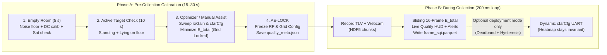

# Radar Configuration Quality & Energy Functions for Pre- and In-Collection Adjustment

**Context:** TI `IWR6843AOP` (60 GHz FMCW mmWave, SDK 3.6 OOB Demo), `vt_radar` recorder (`python main.py record`), top-down indoor floor-posture dataset (`Config_4.cfg`, `256 × 16` Range-Doppler heatmaps + 3D point clouds → CNN-GRU `rnn` and `pointnet` classifiers).

---

## 1. Executive Summary & The Core "Camera AE-Lock" Principle

In photography, **auto-exposure (AE)** and **autofocus (AF)** maximize an image-quality functional (exposure headroom, gradient sharpness, histogram entropy, zero clipping) by adjusting ISO, shutter speed, aperture, and focus before and during capture. Translating this paradigm to FMCW mmWave radar data collection for machine learning requires respecting one critical difference between human photography and ML dataset collection:

> **The AE-Lock Principle for ML Radar Recording:**
> **Before** recording, treat radar tuning like camera AE/AF — run a short active sweep (empty room + live target) to optimize an energy function over RF/DSP settings and verify mounting geometry.
> **During** recording, **lock RF and FFT-grid parameters** (just as videographers use *AE-Lock* to prevent brightness pumping mid-shot) so the recording stays stationary and compatible with downstream neural models. Run the energy function continuously as a **real-time Signal Quality Index (SQI) / exposure meter** to warn the operator, log frame-level usability, and (optionally, only for point-cloud density) adapt runtime-safe `cfarCfg` thresholds that do **not** alter the underlying Range-Doppler heatmap.

This project's own data history illustrates why this separation matters:
- Ten `Experiment_1.cfg` recordings had to be discarded because `guiMonitor` omitted the point-cloud TLV and the range bin was `0.7687 m` (putting an entire person in 2–3 bins) (`docs/data_notes/floor-posture-cohorts.md`).
- Even among retained `Config_4.cfg` recordings, the point cloud yields a **median of 2 points/frame with 27% empty frames** (`docs/modeling.md`), and the empty-room heatmap noise floor shifts by `100–180` raw units across recordings.
- Changing RF parameters (`profileCfg`, `frameCfg`, `clutterRemoval`) mid-recording would break range-bin spacing, Doppler scale, and noise-floor stationarity inside a single `.h5` session, creating severe covariate shift for the `rnn` model.

---

## 2. Mapping the Camera Analogy to TI `IWR6843AOP` Hardware

Every intuitive camera adjustment maps directly to a specific TI mmWave CLI parameter and observable TLV signal in `src/vt_radar/`:

| Camera Concept | Radar Equivalent (`TI IWR6843AOP`) | `.cfg` Command / Knob | Observable in `vt_radar` | Runtime-Safe Without `sensorStop`? |
| :--- | :--- | :--- | :--- | :--- |
| **Exposure / ISO Gain** | Receiver analog/IF gain & TX power backoff | `profileCfg` (`rxGain`, `txOutPowerBackoff`) | Heatmap floor & peak (`uint16`), point `SNR` & `Noise` (0.1 dB) | **No** (requires `sensorStop` → `flushCfg` → `sensorStart`) |
| **Highlight Clipping / Zebras** | ADC / LNA saturation from close strong reflectors (ceiling fixture, metal) | `rxGain`, `hpfCornerFreq1/2`, `txOutPowerBackoff`, `CQRxSatMonitor`, `analogMonitor` | `CQRxSatMonitor` saturation count; heatmap values near `65535` ceiling | Monitor configured pre-start; `rxGain` requires stop/start |
| **Dark Frame / Black Level** | Empty-room static clutter & TX-RX antenna leakage (DC bin) | `calibDcRangeSig`, `clutterRemoval` | Range bins `0..5` spike; zero-Doppler ridge in `rangeDopplerHeatmap` | `clutterRemoval` / `calibDcRangeSig` generally set pre-start (and must stay fixed per ML recording) |
| **Focus / Spatial Resolution** | Bandwidth (range res), chirp count (Doppler res), unambiguous range/velocity | `profileCfg` (`freqSlopeConst`, `numAdcSamples`, `digOutSampleRate`), `frameCfg` (`numLoops`) | `range_resolution_m`, `bin_spacing_m`, `max_range`, target spread in RD map | **No** — and **must stay locked** across an ML cohort (e.g. `256 × 16`, `0.0237 m/bin`) |
| **Edge / Feature Thresholding** | Detection threshold separating target points from noise/clutter | `cfarCfg` (range & Doppler `thresholdScale`, mode `CA/OS/GO/SO`, `peakGrouping`), `multiObjBeamForming` | `numDetectedPoints`, point `SNR`, spatial clustering, empty-frame rate | **Yes** — TI mmWave SDK explicitly documents `cfarCfg` as dynamically updatable while running (and it does **not** mutate the RD heatmap) |
| **Framing / Crop (ROI)** | Physical mounting height, tilt, and angular/range FoV | Physical mount, `cfarFovCfg`, `aoaFovCfg` | Floor-peak range bin (~1.8–2.5 m), point `(x, y, z)` footprint | Pre-recording verification (manual mount + `.cfg` bounds) |
| **Dropped Frames / Thermal Drift** | UART framing errors, DSP overload, RF die heating | `frameCfg` (`framePeriodicity`), `guiMonitor` | `frameNum` gaps, `heatmap_ok`, `parseStatsTLV` margins, `parseTemperatureStatsTLV` | Monitored continuously live |

> **Hardware note on `vt_radar`:** Currently, `Config_4.cfg` sets `analogMonitor 0 0` (leaving TI's built-in `CQRxSatMonitor` and `CQSigImgMonitor` inactive) and `guiMonitor -1 1 1 0 0 1 1` (disabling the noise-profile TLV). Furthermore, `src/vt_radar/parsing_utils/parseFrame.py` currently logs an error and skips `MMWDEMO_OUTPUT_MSG_NOISE_PROFILE`. Enabling noise-profile parsing and chirp-quality monitors is a high-leverage prerequisite for hardware-grounded quality scoring.

---

## 3. Paper-Backed Literature Review of Radar Quality & Energy Functions

Five established research families provide mathematically grounded energy functions for assessing radar signal clarity and downstream usability.

### Family 1: Radar Image Autofocus & Focus/Sparsity Energy (SAR / ISAR)

In Synthetic Aperture Radar (SAR) and Inverse SAR (ISAR), *autofocusing* automatically tunes unknown signal parameters by optimizing a blind image-quality functional — the direct radar counterpart to camera autofocus.

1. **Minimum Image Entropy (Shannon Entropy)** — Xi, Liu & Ni (*IEEE TAES*, 1999) [1]; Wang, Liu & Zhou (*IEE Proc. Radar, Sonar & Navig.*, 2004) [2].
   Let $P_{r,d} \ge 0$ be the **linear** (or background-subtracted) power at range bin $r$ and Doppler bin $d$ in a Range-Doppler map. Normalize to a probability mass distribution:
   $$p_{r,d} = \frac{P_{r,d}}{\sum_{r',d'} P_{r',d'} + \varepsilon}, \qquad H(P) = -\sum_{r,d} p_{r,d} \ln(p_{r,d} + \varepsilon)$$
   - **Interpretation:** A well-focused, high-SCR target concentrates energy into a compact region of the Range-Doppler plane (**low entropy**). Defocused, smeared, noisy, or saturated heatmaps spread energy uniformly across bins (**high entropy**).
   - **Critical caveat for `Config_4.cfg`:** TI OOB heatmaps are stored as log-magnitude `uint16` values with an elevated non-zero floor. Computing $H$ directly on raw `uint16` values is dominated by the flat background floor. Entropy **must** be computed on the floor-subtracted excess energy $\tilde{P}_{r,d} = \max(I_{r,d} - \hat{b}_r, 0)$ (or linear power $10^{\tilde{P}_{r,d}/c} - 1$).

2. **Normalized Image Contrast (IC)** — Berizzi & Corsini (*IEEE TAES*, 1996) [3]; Martorella, Berizzi & Haywood (*IEE Proc. Radar, Sonar & Navig.*, 2005) [4].
   $$\text{IC}(P) = \frac{\sqrt{\frac{1}{N}\sum_{r,d} \left(P_{r,d} - \bar{P}\right)^2}}{\bar{P}}, \qquad \bar{P} = \frac{1}{N}\sum_{r,d} P_{r,d}$$
   - **Interpretation:** Dimensionless ratio of intensity standard deviation to mean intensity (coefficient of variation). Maximizing $\text{IC}$ (equivalently minimizing $-\text{IC}$) makes real target scatterers stand out sharply against the background noise floor.
   - **Advantage:** Completely **invariant to multiplicative gain scaling** of linear power, making it well suited for comparing different `rxGain` settings when evaluated in linear units.

3. **Generalized Sharpness & Axiomatic Sparsity (Gini Index)** — Fienup & Miller (*JOSA A*, 2003) [5]; Hurley & Rickard (*IEEE Trans. Inf. Theory*, 2009) [6].
   Fienup & Miller generalize sharpness to $S_\alpha(P) = \sum_{r,d} P_{r,d}^\alpha$ ($\alpha > 1$, commonly $\alpha = 2$, the Muller-Buffington squared-intensity metric). However, raw $S_\alpha$ is not scale-invariant across gain changes. Hurley & Rickard [6] evaluate 16 sparsity/concentration measures against 6 formal axioms (*Robin Hood*, *Scaling*, *Rising Tide*, *Cloning*, *Bill Gates*, *Babies*) and prove that the **Gini Index** is the **only** standard measure satisfying all six:
   $$\text{Gini}(P) = 1 - 2 \sum_{k=1}^{N} \frac{P_{(k)}}{\|P\|_1} \left(\frac{N - k + \tfrac{1}{2}}{N}\right), \quad 0 \le P_{(1)} \le P_{(2)} \le \dots \le P_{(N)}$$
   - **Why Gini beats raw entropy & $L_2/L_1$ for radar auto-gain:** Because it satisfies *Scaling* (invariant to multiplying all bins by a gain factor) **and** *Rising Tide* (strictly decreases if the noise floor rises uniformly relative to target peaks), Gini naturally penalizes noise-floor elevation and receiver compression while remaining bounded in $[0, 1]$.

---

### Family 2: Camera Auto-Exposure Energy Functions Adapted to Radar

Modern robotics camera AE algorithms abandoned simple "mean brightness = 128" heuristics because mean brightness fails in high-dynamic-range scenes — the exact same failure mode as indoor radar (strong static ceiling/floor return vs weak lying human return).

4. **Nonlinear Gradient Information Metric** — Shim, Lee & Kweon (*IEEE/RSJ IROS*, 2014 [7]; *IEEE TCSVT*, 2018 [8]).
   Computes the spatial gradient magnitude $g_{r,d} = \|\nabla I(r,d)\|_2$ of the log-magnitude image (here, the Range-Doppler heatmap) and applies a logarithmic activation above a noise threshold $\delta$:
   $$m(g) = \begin{cases} \dfrac{1}{N_\text{norm}} \ln\!\left(\lambda (g - \delta) + 1\right) & g \ge \delta \\ 0 & g < \delta \end{cases}, \qquad M_{\text{grad}}(I) = \sum_{r,d} m(g_{r,d})$$
   - **Why it translates directly to Range-Doppler heatmaps:** If `rxGain` is too low, target returns sink below $\delta$ → $M_{\text{grad}} \to 0$. If `rxGain` is too high, clipping creates flat saturated plateaus whose gradient is $0$, while background noise raises the floor → $M_{\text{grad}}$ drops. Thus $M_{\text{grad}}$ is **unimodal** in gain/exposure, peaking precisely where target contours are cleanest.

5. **Entropy-Weighted Gradient + Saturation Penalty with Bayesian Optimization** — Kim, Cho & Kim (*IEEE ICRA*, 2018) [9]; Zhang, Forster & Scaramuzza (*IEEE ICRA*, 2017) [10].
   Kim et al. combine image entropy, gradient quality, and an explicit clipping penalty into a single black-box objective optimized via **Bayesian Optimization (Gaussian Process)**:
   $$Q_{\text{Kim}}(I) = \alpha \cdot \bar{G}_{\text{weighted}}(I) + (1 - \alpha) \cdot H_{\text{hist}}(I) - \beta \cdot \left(f_{\text{sat}}(I) + f_{\text{floor}}(I)\right)$$
   where $f_{\text{sat}}$ is the fraction of clipped/saturated bins and $f_{\text{floor}}$ is the fraction of under-exposed (noise-clipped) bins.
   - **Key takeaway:** Kim et al. show that evaluating a black-box sensor quality score with **Bayesian Optimization** converges to the optimal exposure setting in **5–10 probe frames** without needing an analytical camera response model — directly applicable to tuning TI radar parameters (`rxGain`, `cfarCfg`) in a 10–15 second pre-recording sweep.

---

### Family 3: Cognitive Radar & Statistical Separability Objectives

6. **Mutual Information & SNR-Matched Illumination** — Bell (*IEEE TIT*, 1993) [11]; Haykin (*IEEE SPM*, 2006) [12]; Leshem, Naparstek & Nehorai (*IEEE JSTSP*, 2007) [13]; Romero, Bae & Goodman (*IEEE TAES*, 2011) [14].
   - Bell [11] established the **Mutual Information** between target impulse response $g$ and received echo $y$ in additive noise/clutter $n$:
     $$I(g; y) = \frac{1}{2} \sum_k \ln\!\left(1 + \frac{\sigma_{g,k}^2}{\sigma_{n,k}^2}\right)$$
   - Romero et al. [14] proved a classic duality directly relevant to ML classification:
     - **Maximizing SNR** puts all energy into the single strongest scattering mode (best for binary *presence detection*).
     - **Maximizing Mutual Information** distributes dynamic range across multiple scattering modes (best for *target characterization / posture classification*, where subtle torso/limb reflections matter more than just the brightest specular bounce).
   - **Practical proxy in `vt_radar`:** Compare an occupied calibration snippet ($P_{\text{occ}}$) against an empty-room baseline ($P_{\text{empty}}$, mean $\mu_{r,d}^{(0)}$ and variance $(\sigma_{r,d}^{(0)})^2$) inside the active human ROI (e.g., range `0.5 m` to floor distance `~2.5 m`):
     - **Active-Zone Signal-to-Clutter-and-Noise Ratio (SCNR):**
       $$\text{SCNR}_{\text{ROI}} = 10 \log_{10}\!\left(\frac{\text{quantile}_{0.98}(\max(I_{\text{ROI}} - \mu^{(0)}_{\text{ROI}}, 0))}{\text{median}(\sigma^{(0)}_{\text{ROI}}) + \varepsilon}\right)$$
     - **Symmetric KL / Deflection Distance (Background-to-Target Separability):**
       $$D_{\text{sep}} = \frac{1}{|\text{ROI}|} \sum_{(r,d) \in \text{ROI}} \frac{\left(\mu^{(1)}_{r,d} - \mu^{(0)}_{r,d}\right)^2}{(\sigma^{(0)}_{r,d})^2 + (\sigma^{(1)}_{r,d})^2 + \varepsilon}$$
       Directly quantifies how easily a downstream classifier can separate "person present / posture state" from empty-room clutter.

---

### Family 4: Radar Signal Quality Index (SQI) & Hardware Dynamic Range

7. **Active Radar Signal Quality Index (SQI)** — Nguyen et al. (*IEEE Sensors Letters*, 2026) [15].
   Formulates an explicit bounded **Signal Quality Index** for Doppler radar human sensing specifically to guide **active positioning / alignment** before and during measurement. Rather than relying on raw amplitude (which can be high due to static clutter or motion artifacts), an effective human-sensing SQI evaluates:
   - Target-band SNR / spectral prominence over noise floor,
   - Temporal continuity (stability of target signature across adjacent frames vs erratic drops),
   - Clutter-to-signal contamination ratio.

8. **FMCW Receiver Dynamic Range, Saturation & Chirp Quality Monitoring** — Texas Instruments *SWRA553A* [16] & mmWave SDK User Guide [17].
   - In short-range top-down indoor deployments (`~1.8–2.5 m` to the floor), specular reflections from the ceiling mount, metal fixtures, or floor can saturate the RX LNA/ADC, causing **intermodulation spurs and harmonic ghost ridges** across the entire Range-Doppler map that *cannot* be removed in post-processing.
   - TI's `CQRxSatMonitor` measures the exact percentage of ADC samples saturated per time slice, and `CQSigImgMonitor` compares in-band signal power against image-band interference. Pairing hardware saturation counters with heatmap ceiling checks (`frac(I >= 0.95 * I_max)`) gives an exact, physics-backed **clipping barrier** in the energy function.

---

### Family 5: Indoor Extended-Target CFAR & Point-Cloud Usability

9. **Temporal vs. Spatial CFAR for Indoor mmWave Point Clouds** — Yang et al. (*ACM IMWUT*, 2025, ETCM-CFAR) [18].
   - Demonstrates why standard spatial CA-CFAR (such as `Config_4.cfg`'s `cfarCfg -1 0 2 8 4 3 0 15 1` and `cfarCfg -1 1 0 4 2 3 1 15 1`) performs poorly for indoor human sensing: at `1.5–3 m`, a human body is an **extended target** spanning multiple range and Doppler bins, so neighboring body reflections spill into the CFAR reference window, inflating the local noise estimate and **self-masking the person**.
   - This directly explains the repo's empirical finding in `docs/modeling.md`: `Config_4.cfg` produces **0 to 16 points/frame (median 2; 27% empty frames)** — starving `pointnet` of spatial geometry, especially when a person lies still on the floor.
   - **Implication for our energy function:** For `pointnet` usability, we must explicitly score **point-cloud yield inside the human ROI** (penalizing both starvation `< 2 pts/frame` and false-alarm flooding `> 12 pts/frame` that causes `max_points = 128` truncation per 16-frame window), weighted by point SNR margin and spatial compactness.

---

## 4. Comparative Matrix of Candidate Energy Functions

| Energy / Metric | Primary Reference | Catches Under-Gain / Low SNR | Catches Saturation / Clipping | Catches Clutter / Floor Shift | Catches Point-Cloud Starvation | Scale / Gain Invariant? | Needs Empty-Room Ref? | Live Cost (per 200 ms frame) |
| :--- | :--- | :---: | :---: | :---: | :---: | :---: | :---: | :---: |
| **Shannon Image Entropy** $H(\tilde{P})$ | Xi et al. 1999 [1]; Wang et al. 2004 [2] | Partial | Partial | Yes (if floor-sub.) | No | Yes | Recommended | `< 0.5 ms` |
| **Normalized Image Contrast (IC)** | Berizzi & Corsini 1996 [3]; Martorella et al. 2005 [4] | Yes | Partial | Yes | No | Yes | Recommended | `< 0.2 ms` |
| **Gini Sparsity Index** | Hurley & Rickard 2009 [6] | Yes | Yes (flat ceiling lowers Gini) | Yes (Rising Tide) | No | Yes | Recommended | `~0.8 ms` (sort 4096 bins) |
| **Shim Gradient Metric** $M_{\text{grad}}$ | Shim et al. 2014/2018 [7, 8] | Yes | Yes (clipped = 0 grad) | Partial | No | No (threshold $\delta$) | No | `< 0.5 ms` |
| **Kim Entropy-Grad + Clip Penalty** | Kim et al. 2018 [9] | Yes | **Strong** | Yes | No | Tuned | No | `~1.0 ms` |
| **ROI SCNR & Deflection $D_{\text{sep}}$** | Bell 1993 [11]; Romero et al. 2011 [14] | **Strong** | No (alone) | **Strong** | No | Yes | **Yes** | `< 0.3 ms` |
| **Hardware Saturation + Transport Gate** | TI SWRA553A [16]; SDK Guide [17] | No | **Exact (ADC)** | No | Detects missing TLV | N/A | No | `< 0.1 ms` |
| **Point-Cloud Yield / Coherence Energy** | Yang et al. 2025 [18] | Indirect | Indirect | Yes (false alarms) | **Strong** | N/A | Optional | `< 0.3 ms` |

**Key Insight:** **No single scalar metric catches every failure mode.**
- Entropy / Contrast / Gini alone can be fooled by a single saturated metallic reflector (high contrast, low entropy, completely useless for a lying human).
- Raw SNR alone rewards turning `rxGain` up until ADC clipping occurs.
- Heatmap metrics alone cannot detect a misconfigured `cfarCfg` or disabled `detectedObjects` TLV (the exact failure mode that ruined the 10 `Experiment_1.cfg` recordings).

Therefore, the right formulation is a **barrier-gated composite energy function** whose individual sub-energies remain inspectable for manual guidance.

---

## 5. Recommended Composite Energy Function: $E_{\text{radar}}$

Define a **minimization energy** $E_{\text{total}} \in [0, \infty)$ (lower is better; mapped to a human-friendly $[0, 100]$ **Radar Usability Score** $Q = 100 \cdot \exp(-E_{\text{total}})$ for live HUD display). Evaluate over a sliding window $W$ of $T = 16$ frames (`3.2 s`, matching `windowing.window_len` in `config/data.yaml`).

$$E_{\text{total}}(\theta; W) = E_{\text{gate}}(W) + w_{\text{head}} E_{\text{headroom}} + w_{\text{focus}} E_{\text{focus}} + w_{\text{sep}} E_{\text{sep}} + w_{\text{pc}} E_{\text{pc}} + w_{\text{stab}} E_{\text{stab}}$$

### Term 0: Hard Usability Barrier $E_{\text{gate}}$ (Fail-Fast Structural Check)
Returns $+\infty$ (hard red flag: **DO NOT RECORD / UNUSABLE**) if any structural requirement fails:
1. **Schema / TLV integrity:** `heatmap_ok == False` on $> 5\%$ of frames, or `detectedObjects` TLV absent (catches `Experiment_1.cfg` immediately).
2. **Grid compatibility (ML cohort lock):** `(num_range_bins, num_doppler_bins)` or `bin_spacing_m` deviates from target cohort (e.g., `Config_4`: `256 × 16`, `bin_spacing_m ≈ 0.0237 m`).
3. **Transport / timing integrity:** Frame-drop rate (from `frameNum` increments) $> 2\%$, or `interFrameProcessingMargin == 0` in `parseStatsTLV`.
4. **Severe ADC / heatmap saturation:** `CQRxSatMonitor` saturation ratio $> 1\%$ OR $> 0.5\%$ of heatmap cells hit the `uint16` ceiling.

### Term 1: Dynamic-Range & Exposure Headroom $E_{\text{headroom}}$ (Camera Auto-Exposure Equivalent)
Prevents both clipping (too hot) and quantization/floor burial (too cold), inspired by Kim et al. [9]:
$$E_{\text{headroom}} = \lambda_{\text{sat}} \cdot \max\!\left(0, \frac{q_{0.999}(I) - I_{\text{hi}}}{I_{\max} - I_{\text{hi}}}\right)^2 + \lambda_{\text{low}} \cdot \max\!\left(0, \frac{D_{\min} - \left(q_{0.995}(I_{\text{ROI}}) - q_{0.20}(I_{\text{ROI}})\right)}{D_{\min}}\right)^2$$
- Penalizes peak heatmap values approaching ceiling $I_{\text{hi}}$ (e.g., $0.85 \cdot I_{\max}$ or ADC headroom $< 6\text{ dB}$).
- Penalizes compressed dynamic range where the 99.5th-percentile return in the human ROI is not at least $D_{\min}$ above the 20th-percentile noise floor.

### Term 2: Heatmap Focus & Feature Sharpness $E_{\text{focus}}$ (Autofocus + Gradient Information)
Combines Hurley & Rickard's scale-invariant **Gini Index** [6] on the floor-subtracted Range-Doppler excess map $\tilde{P}_{r,d} = \max(I_{r,d} - \hat{b}_r, 0)$ inside the ROI with Shim et al.'s **nonlinear gradient energy** [7, 8]:
$$E_{\text{focus}} = \left(1 - \text{Gini}(\tilde{P}_{\text{ROI}})\right) + \gamma \cdot \exp\!\left(-\frac{M_{\text{grad}}(I_{\text{ROI}})}{M_0}\right)$$
- Rewards crisp, well-localized human reflections in Range-Doppler space (including micro-Doppler limbs/breathing) and penalizes smeared noise or flat saturated plateaus.
- Works **both** with and without an empty-room baseline (using per-frame robust range-median floor $\hat{b}_r$ when no baseline is stored).

### Term 3: Target-to-Background Separability $E_{\text{sep}}$ (Cognitive Radar / SCNR)
Used whenever an empty-room reference $(\mu^{(0)}, \sigma^{(0)})$ is captured during pre-flight calibration (or via slow empty-scene initialization):
$$E_{\text{sep}} = \exp\!\left(-\frac{\max(\text{SCNR}_{\text{ROI}}, 0)}{\tau_{\text{scnr}}}\right) + \eta \cdot \exp\!\left(-\frac{D_{\text{sep}}}{\tau_{\text{sep}}}\right)$$
- Directly measures whether a human (especially **lying on the floor** near the floor range bin!) produces statistically separable energy above static room clutter (e.g., target $\text{SCNR}_{\text{ROI}} \ge 12\text{–}15\text{ dB}$).
- Also flags **static-clutter over-suppression**: if `clutterRemoval` is enabled and a stationary lying person vanishes into the background, $\text{SCNR}_{\text{ROI}}$ during the lying calibration check drops toward $0\text{ dB}$, immediately raising $E_{\text{sep}}$!

### Term 4: Point-Cloud Usability Energy $E_{\text{pc}}$ (Tailored to `PointNet` & Indoor CFAR)
Directly guards against the `Config_4` starvation problem (median 2 pts/frame, 27% empty frames) and the `max_points = 128` window truncation cap:
$$E_{\text{pc}} = \underbrace{\left(\frac{\bar{n}_W - n^*}{n_{\text{scale}}}\right)^2}_{\text{density band}} + \lambda_{\text{empty}} f_{\text{empty}}(W) + \lambda_{\text{snr}} \max\!\left(0, \frac{\text{SNR}_{\min} - \text{median}(\text{SNR}_{\text{ROI}})}{\text{SNR}_{\min}}\right)^2 + \lambda_{\text{ghost}} f_{\text{oob}}(W)$$
where:
- $\bar{n}_W$ is total ROI points per 16-frame window, targeting $n^* \approx 64\text{–}80$ (i.e., `4–5 pts/frame`, comfortably inside `PointNet`'s `128`-point cap without truncating or starving).
- $f_{\text{empty}}(W)$ is the fraction of zero-point frames in the window (currently `0.27`; target `< 0.05` when a person is present).
- $\text{median}(\text{SNR}_{\text{ROI}})$ ensures detections carry real margin above noise (e.g., $\ge 10\text{ dB}$).
- $f_{\text{oob}}(W)$ is the fraction of points falling outside the plausible room/floor bounding box (penalizes multipath ghosts or overly loose CFAR thresholds).

### Term 5: Temporal & Thermal Stability $E_{\text{stab}}$ (Live Drift Monitor)
Tracks slow degradation during long recordings:
$$E_{\text{stab}} = \left(\frac{\|\hat{b}(t) - \hat{b}(t_0)\|_2}{\|\hat{b}(t_0)\|_2 + \varepsilon}\right)^2 + \lambda_T \cdot \max\!\left(0, \frac{|T_{\text{die}}(t) - T_{\text{die}}(t_0)| - \Delta T_{\text{tol}}}{\Delta T_{\text{tol}}}\right)^2$$
- Flags noise-floor drift (e.g., caused by RF self-heating after cold start, a moved piece of furniture, or environmental interference) and die temperature excursions from `parseTemperatureStatsTLV` (e.g., $\Delta T_{\text{tol}} = 10\,^\circ\text{C}$).

### Suggested Starting Weights (Before Empirical Calibration)
Normalize each sub-term to $\mathcal{O}(1)$ at nominal acceptable quality and start with:
- $w_{\text{head}} = 0.30$ (protect dynamic range / zero clipping first — unrecoverable if bad)
- $w_{\text{sep}} = 0.25$ (target visibility above static room clutter)
- $w_{\text{pc}} = 0.25$ (eliminate `PointNet` starvation without ghost flooding)
- $w_{\text{focus}} = 0.15$ (Range-Doppler sharpness & sparsity)
- $w_{\text{stab}} = 0.05$ (drift monitoring during long runs)

*(Exact weights should be calibrated against downstream CV F1 / balanced loss on the existing 25 recordings in Phase 1 below.)*

---

## 6. Best Path Forward: Two-Stage Architecture (Before vs. During Collection)

### Stage A: Before Data Collection (Auto or Guided Manual Adjustment)

1. **Lock the ML-invariant geometry first:** Never auto-vary `freqSlopeConst`, `numAdcSamples`, `digOutSampleRate`, `numLoops`, or `framePeriodicity` when collecting data for an existing model cohort (`Config_4`: `256 × 16`, `0.2 s/frame`, `0.0237 m/bin`).
2. **Step 1 — Empty-Room Pre-Flight (5 s, ~25 frames):**
   - Enable `analogMonitor 1 1` and `guiMonitor` noise profile.
   - Verify `E_gate` passes (valid TLVs, expected shape, zero dropped frames, zero saturation).
   - Measure the room's static range profile $\mu^{(0)}$, noise variance $\sigma^{(0)}$, and check that the dominant static floor peak matches the expected mounting height (`~1.8–2.5 m`). Warn immediately if the sensor is tilted awkwardly or blocked by a near-field obstacle (`< 0.4 m`).
3. **Step 2 — Active Target Calibration (10 s, ~50 frames: person walks in & lies on floor):**
   - **Auto mode (Bayesian Optimization / Coordinate Search):** Following Kim et al. [9], run a tiny 6–10 evaluation sweep (or 2D grid/BO over safe discrete sets) tuning:
     - `rxGain` $\in \{24, 28, 30, 34, 38, 42\}\text{ dB}$ (requires brief `sensorStop`/`sensorStart`, ~0.5 s per step) — minimizes $E_{\text{headroom}} + E_{\text{focus}} + E_{\text{sep}}$.
     - `cfarCfg` range & Doppler `thresholdScale` $\in \{8, 10, 12, 15\}\text{ dB}$ (runtime-safe, instant) and mode (`CA-CFAR` vs `OS-CFAR` / `GO-CFAR`) — minimizes $E_{\text{pc}}$.
   - **Manual-assist mode:** Show the operator the live decomposed sub-scores (`Headroom`, `Clutter Sep`, `Focus`, `Point Density`, `Mount Height`) with plain-English actionable hints (e.g., *"ADC saturating at 0.3 m — lower rxGain or move away from ceiling beam"*, *"Lying person yields 0.6 pts/frame — lower CFAR threshold from 15 dB to 11 dB"*).
4. **Step 3 — Lock & Stamp (`AE-Lock`):**
   - Write the chosen `.cfg` plus `quality_meta.json` (empty-room floor $\mu^{(0)}, \sigma^{(0)}$, baseline die temperature, pre-flight $E_{\text{total}}$ and sub-scores) into `recording/<YYYYMMDD_HHMMSS>/`.

### Stage B: During Data Collection (Online Monitoring vs. Controlled Adaptation)

1. **For ML Training Dataset Collection — Monitor & Gate, Do Not Mutate RF:**
   - Compute $E_{\text{total}}$ every frame on the trailing 16-frame buffer (`< 2 ms` CPU time — negligible next to the `200 ms` frame period, safe even on Raspberry Pi).
   - Display a compact terminal status line (replacing or extending the `Halo` spinner in `src/vt_radar/recording_utils/recorder.py`):
     `Recording... Q=84/100 [Headroom: OK | Sep: 14.2dB | Pts: 5.1/f | Sat: 0% | Drops: 0 | Temp: 46°C]`
   - Persist per-frame quality telemetry (`quality_log.csv` or column in HDF5) so `python main.py bake` can report usability statistics and flag corrupted windows automatically before manual camera annotation!
2. **Optional Live Adaptation — Runtime-Safe `cfarCfg` Only (Deployment / Exploratory Mode):**
   - Because TI's SDK allows updating `cfarCfg` over the CLI UART **without** `sensorStop`, and because CFAR runs *after* the 2D Range-Doppler FFT, adjusting `cfarCfg` **does not corrupt the `rangeDopplerHeatmap` tensor** while dynamically preventing `pointnet` point-cloud starvation!
   - Guard any live `cfarCfg` controller with:
     - **Occupancy gate:** Only adapt when `E_sep` / heatmap energy confirms a person is present (never lower threshold down into noise when the room is empty!).
     - **Deadband + Hysteresis:** Only step `thresholdScale` by $\pm 1\text{ dB}$ if rolling 5 s point density stays outside `[3, 9] pts/frame` for 3 consecutive windows, clamped to `[8, 18] dB`, with a minimum `10 s` cooldown.
     - **Full audit log:** Record every dynamic CLI command and its exact `frame_idx` timestamp into the session folder so replay and ML preprocessing always know the exact threshold active on every frame.

---

## 7. Concrete Implementation Roadmap for This Repository

| Phase | Scope | Files Touched | Validation Criterion |
| :--- | :--- | :--- | :--- |
| **Phase 1: Offline Energy Validation** | Implement `E_gate`, `E_headroom`, `E_focus` (Gini + Shim gradient), `E_sep`, `E_pc` and score all 25 existing recordings (plus synthetic corrupted/saturated/empty perturbations). | New `src/vt_radar/quality.py` + exploration script/notebook | Verify energy cleanly separates high-usability Cohort A recordings from low-point-density, floor-shifted, and bad-config recordings, and correlates with per-recording `rnn`/`pointnet` error rates. |
| **Phase 2: Hardware Telemetry & Pre-Flight Check** | Parse `MMWDEMO_OUTPUT_MSG_NOISE_PROFILE` in `parseFrame.py`; test enabling `analogMonitor 1 1` & noise profile on `IWR6843AOP`; add `--check-only` / pre-flight wizard + live quality HUD to `python main.py record`. | `src/vt_radar/parsing_utils/parseFrame.py`, `parseTLVs.py`, `src/vt_radar/recording_utils/recorder.py` | Live loop adds `< 3 ms/frame` overhead; operator sees real-time score + actionable warnings; `quality_meta.json` & per-frame SQI saved beside `.h5` chunks. |
| **Phase 3: Pre-Collection Auto-Tuner** | Add `python main.py calibrate` (empty-room + active target sweep using coordinate search or GP Bayesian Optimization over `rxGain` and `cfarCfg`, locking FFT grid to `Config_4`). | New `src/vt_radar/recording_utils/calibrate.py`, `main.py` | Converges in `< 30 s`; increases lying-posture point density from median `2 pts/frame` (27% empty) to `4–6 pts/frame` (`< 5%` empty) with `0%` ADC saturation. |
| **Phase 4: Guarded Live CFAR Assist (Optional)** | Add opt-in `--auto-cfar` flag with occupancy gate, deadband, hysteresis, and CLI change logging. | `src/vt_radar/recording_utils/recorder.py`, `record_tlv.py` | Zero dropped frames during UART updates; heatmap distribution strictly unchanged; logged threshold transitions replay cleanly. |

---

## 8. References

1. **Xi, L., Liu, G.-S., & Ni, J. (1999).** *Autofocusing of ISAR images based on entropy minimization.* IEEE Transactions on Aerospace and Electronic Systems, 35(4), 1240–1252. DOI: [10.1109/7.805442](https://doi.org/10.1109/7.805442)
2. **Wang, J., Liu, X., & Zhou, Z. (2004).** *Minimum-entropy phase adjustment for ISAR.* IEE Proceedings – Radar, Sonar and Navigation, 151(4), 203–209. DOI: [10.1049/ip-rsn:20040692](https://doi.org/10.1049/ip-rsn:20040692)
3. **Berizzi, F., & Corsini, G. (1996).** *Autofocusing of inverse synthetic aperture radar images using contrast optimization.* IEEE Transactions on Aerospace and Electronic Systems, 32(3), 1185–1191. DOI: [10.1109/7.508512](https://doi.org/10.1109/7.508512)
4. **Martorella, M., Berizzi, F., & Haywood, B. (2005).** *Contrast maximisation based technique for 2-D ISAR autofocusing.* IEE Proceedings – Radar, Sonar and Navigation, 152(4), 253–262. DOI: [10.1049/ip-rsn:20045123](https://doi.org/10.1049/ip-rsn:20045123)
5. **Fienup, J. R., & Miller, J. J. (2003).** *Aberration correction by maximizing generalized sharpness metrics.* Journal of the Optical Society of America A (JOSA A), 20(4), 609–620. DOI: [10.1364/JOSAA.20.000609](https://doi.org/10.1364/JOSAA.20.000609)
6. **Hurley, N., & Rickard, S. (2009).** *Comparing Measures of Sparsity.* IEEE Transactions on Information Theory, 55(10), 4723–4741. DOI: [10.1109/TIT.2009.2027527](https://doi.org/10.1109/TIT.2009.2027527)
7. **Shim, I., Lee, J.-Y., & Kweon, I. S. (2014).** *Auto-adjusting camera exposure for outdoor robotics using gradient information.* IEEE/RSJ International Conference on Intelligent Robots and Systems (IROS), 1011–1017. DOI: [10.1109/IROS.2014.6942682](https://doi.org/10.1109/IROS.2014.6942682)
8. **Shim, I., Oh, T.-H., Lee, J.-Y., Choi, J., Choi, D.-G., & Kweon, I. S. (2018).** *Gradient-Based Camera Exposure Control for Outdoor Mobile Platforms.* IEEE Transactions on Circuits and Systems for Video Technology, 29(6), 1569–1583. DOI: [10.1109/TCSVT.2018.2846292](https://doi.org/10.1109/TCSVT.2018.2846292)
9. **Kim, J., Cho, Y., & Kim, A. (2018).** *Exposure Control Using Bayesian Optimization Based on Entropy Weighted Image Gradient.* IEEE International Conference on Robotics and Automation (ICRA), 857–864. DOI: [10.1109/ICRA.2018.8462881](https://doi.org/10.1109/ICRA.2018.8462881)
10. **Zhang, Z., Forster, C., & Scaramuzza, D. (2017).** *Active Exposure Control for Robust Visual Odometry in HDR Environments.* IEEE International Conference on Robotics and Automation (ICRA), 3894–3901. DOI: [10.1109/ICRA.2017.7989449](https://doi.org/10.1109/ICRA.2017.7989449)
11. **Bell, M. R. (1993).** *Information theory and radar waveform design.* IEEE Transactions on Information Theory, 39(5), 1578–1597. DOI: [10.1109/18.259642](https://doi.org/10.1109/18.259642)
12. **Haykin, S. (2006).** *Cognitive radar: a way of the future.* IEEE Signal Processing Magazine, 23(1), 30–40. DOI: [10.1109/MSP.2006.1593335](https://doi.org/10.1109/MSP.2006.1593335)
13. **Leshem, A., Naparstek, O., & Nehorai, A. (2007).** *Information Theoretic Adaptive Radar Waveform Design for Multiple Extended Targets.* IEEE Journal of Selected Topics in Signal Processing, 1(1), 42–55. DOI: [10.1109/JSTSP.2007.900103](https://doi.org/10.1109/JSTSP.2007.900103)
14. **Romero, R. A., Bae, J., & Goodman, N. A. (2011).** *Theory and Application of SNR and Mutual Information Matched Illumination Waveforms.* IEEE Transactions on Aerospace and Electronic Systems, 47(2), 912–927. DOI: [10.1109/TAES.2011.5751234](https://doi.org/10.1109/TAES.2011.5751234)
15. **Nguyen, H.-S., Kurosawa, M., Yen, H. T., Hashimoto, T., Pham, C.-K., & Sun, G. (2026).** *A Signal Quality Index for Active Positioning of CW Doppler Radar in Vital-Sign Monitoring.* IEEE Sensors Letters, 10, 1–4, Art. no. 3506704. DOI: [10.1109/LSENS.2026.3737169](https://doi.org/10.1109/LSENS.2026.3737169)
16. **Texas Instruments (2020).** *Programming Chirp Parameters in TI Radar Devices* (Application Report SWRA553A).
17. **Texas Instruments (2021).** *mmWave SDK User Guide* (SDK v03.06 — CLI configuration, runtime `cfarCfg`, and `CQRxSatMonitor` / `analogMonitor`).
18. **Yang, H., Zhang, D., Zhang, X., Xiong, J., Fan, Z., Ning, W., Chen, W., Zhang, F., Han, Z., & Zhang, D. (2025).** *From Spatial Domain to Temporal Domain: Unleashing the Capability of CFAR for mmWave Point Cloud Generation.* Proceedings of the ACM on Interactive, Mobile, Wearable and Ubiquitous Technologies (IMWUT). DOI: [10.1145/3729465](https://doi.org/10.1145/3729465)