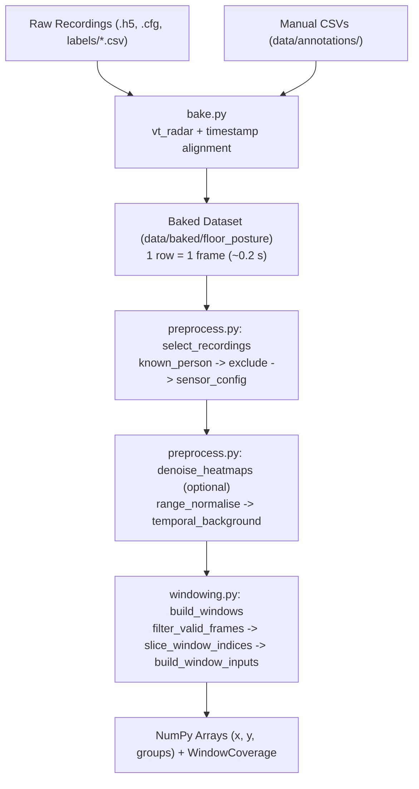

# Data Pipeline (`src/data/`)

Converts raw mmWave radar recordings and hand-made CSV annotations into a unified Hugging Face dataset on disk, filters and denoises frames, cuts gap-safe sliding windows into model input tensors, and supplies training-only batch augmentations and resampling.


## Modules

| Module             | Responsibility                                                                                                                                                        |
| ------------------ | --------------------------------------------------------------------------------------------------------------------------------------------------------------------- |
| `bake.py`        | Parses raw recordings via `vt_radar` into `data/baked/floor_posture` and refreshes hand annotations without re-parsing raw files.                                 |
| `annotations.py` | Canonical capture-time ordering (`capture_positions`), lying-interval CSV I/O, and dataset column attachers (`person`, `person_present`, `lying_annotation`). |
| `preprocess.py`  | Recording selection (`select_recordings`) and optional per-recording heatmap denoising (`denoise_heatmaps`).                                                      |
| `windowing.py`   | Frame validation funnel (`WindowCoverage`), gap-checked window slicing, label rules, and tensor builders (`build_windows`).                                       |
| `augment.py`     | Training-only batch transforms (`HeatmapAugment`, `PointAugment`) with mutual-exclusion conflict groups.                                                          |
| `resample.py`    | Training-only minority-class oversampling (`RandomOversampler`).                                                                                                    |


## Pipeline Walkthrough




### 1. Baking and Annotation Refresh (`bake.py`, `annotations.py`)

`bake_dataset()` reads `MANIFEST.csv` under `paths.raw_root`, parses each recording's `.cfg` and `.h5` files in parallel via `vt_radar`, aligns raw `labels/*.csv` tracks to frame timestamps within $`\pm 2\,\mu\text{s}`$, attaches manual annotations from `paths.annotations_dir`, and writes the resulting Arrow dataset to `paths.baked_dir`.

Because `.h5` chunks are read alphabetically (for example `data_10.h5` before `data_2.h5`), canonical temporal order is computed by `capture_positions(meta)` using a stable sort on `(recording, timestamp, frame_idx)`.

`attach_annotations()` joins three manual tracks from `data/annotations/`:

- `person` (`person_map.csv`): participant pseudonym per recording, or `"NA"` if unlisted.
- `person_present` (`presence_events.csv`): boolean occupancy reconstructed from `enter`/`leave` events, or `None` for unannotated recordings.
- `lying_annotation` (`lying_intervals.csv`): `"lying"` inside inclusive `[first_capture_idx, last_capture_idx]` intervals and `"not_lying"` outside them when `reviewed=true`, or `None` when unreviewed.

Unlabelled frames stay intact on disk. After editing any CSV in `data/annotations/`, `refresh_annotations()` replaces the three annotation columns into a sibling directory, releases Arrow memory maps, and swaps the directory in place without re-reading raw `.h5` files.


### 2. Recording Selection and Optional Denoising (`preprocess.py`)

`preprocess_dataset(ds, selection, denoising)` runs identically on all splits before windowing:

1. **Selection (`select_recordings`):** Drops recordings with `person == "NA"` (always enabled to prevent participant leakage), drops recordings listed in `selection.exclude_recordings`, and keeps `selection.sensor_config` (default `Config_4.cfg`, `256 x 16` bins).
2. **Heatmap denoising (`denoise_heatmaps`, both disabled by default):** Rewrites heatmaps one recording at a time in capture order, clipped at $`0`$ as `float32`. No statistics are pooled across recordings.
   - `RangeNormalise` (non-causal): computes a per-range-bin floor $`f_r = \text{Percentile}_p(H[:, r, :])`$ over the recording's time and Doppler axes, smooths $`f_r`$ along range with an odd running median of width `smooth_bins` (default `41`), and outputs $`\max(H - \tilde{f}_r, 0)`$.
   - `TemporalBackground` (causal): tracks an exponential moving average $`b_t = \alpha H_{t-1} + (1 - \alpha) b_{t-1}`$ with $`\alpha = 1 / \tau`$ (default $`\tau = 300`$ frames, roughly $`60\,\text{s}`$, initialized at $`b_0 = H_0`$) and outputs $`\max(H_t - b_t, 0)`$.


### 3. Frame Filtering, Window Slicing, and Input Tensors (`windowing.py`)

`build_windows(ds, windowing, input_type, max_per_person, seed)` runs three stages:

1. **`filter_valid_frames`:** Assigns `capture_idx` before dropping rows, then applies three exclusive checks in order: target label is non-null, `heatmap_ok` is `True`, and `(num_range_bins, num_doppler_bins) == (256, 16)`. Counts at each drop stage are recorded in `WindowCoverage` and logged.
2. **`slice_window_indices`:** Slides windows of `window_len` frames (default `16`, roughly $`3.2\,\text{s}`$) with step `stride` (default `8`) in `capture_idx` order. Any window spanning dropped frames (`capture_idx[last] - capture_idx[start] != window_len - 1`) is skipped and counted in `windows_gap_skipped`.
   - **`label_rule="any_lying"`:** Assigns the last `lying*` label present in the window, or the final frame's label if none is lying.
   - **`label_rule="last"`:** Assigns the final frame's label.
   - **`collapse_lying=True`:** Maps any label starting with `"lying"` to `"lying"` and every other label to `"not_lying"`.
3. **`build_window_inputs`:** Returns `(x, y, groups, coverage)` with string arrays `y` and `groups` of shape `(N,)` and `x` determined by the model's `input_type`:

| `input_type`   | Shape & Dtype                       | Representation                                                                                                                                                                                                                                                                                       |
| ---------------- | ----------------------------------- | ---------------------------------------------------------------------------------------------------------------------------------------------------------------------------------------------------------------------------------------------------------------------------------------------------- |
| `"heatmap"`    | `(N, T, 1, 256, 16)`, `float32` | $`\log(1 + H)`$ (`np.log1p`). Zero velocity stays at Doppler bin `0` (not `fftshift`-centred).                                                                                                                                                                                                 |
| `"pointcloud"` | `(N, max_points, 7)`, `float32` | All radar points across the $`T`$ frames pooled into one set: `[x, y, z, doppler, snr, t_norm, valid]`, where $`t_{\text{norm}} = t / \max(T - 1, 1) \in [0, 1]`$ and `valid` is `1` for real points or `0` for padding. Windows exceeding `max_points` (128) keep the highest-SNR points. |
| `"none"`       | `(N, T)`, `float32`             | Zero placeholder array for label-only baselines.                                                                                                                                                                                                                                                     |

### 4. Training-Only Augmentations and Resampling (`augment.py`, `resample.py`)


Applied only to training folds inside `src/training/fitting.py`. When two enabled transforms belong to the same `CONFLICTS` group, each window executes exactly one of them chosen uniformly at random.

- **`HeatmapAugment`** (sized for Config 4, $`0.0237\,\text{m}`$ per range bin):
  1. `time_reverse`: reverses the time axis with probability $`0.5`$.
  2. `range_shift_bins` / `floor_jitter` *(conflict group)*: fractional linear shift along range filled with the per-Doppler median noise floor, or an 8-knot smooth baseline added in raw heatmap space before re-applying $`\log(1 + \cdot)`$.
  3. `noise`: Gaussian noise scaled by the training heatmap standard deviation (`set_input_std`).
- **`PointAugment`** (sensor frame: $`y`$ is boresight distance to the floor, $`x\text{-}z`$ is the floor plane):
  1. `mirror` ($`x \mapsto -x`$, $`p = 0.5`$) / `yaw_deg` (rotation about $`y`$) *(conflict group)*, plus `tilt_deg` (rotations about $`x`$ and $`z`$).
  2. `shift_m` ($`x, z`$) and `height_m` ($`y`$): drops points moved beyond $`r_{\text{max}} = 4.85\,\text{m}`$ and rescales SNR by the radar $`R^{-4}`$ power law:

     ```math
     \text{SNR}' = \text{SNR} + 40 \log_{10}\!\left(\frac{r_{\text{old}}}{r_{\text{new}}}\right)
     ```

  3. `snr_jitter_db` (per-window Gaussian dB offset) and `ghost_points` (Poisson false alarms placed in empty padding slots within a $`60^\circ`$ boresight cone).
  4. `apply_with_count()` records the pre-drop point count `n_points`, then applies `point_drop` and Gaussian `jitter` scaled by the training per-feature standard deviation.
- **`RandomOversampler`:** Keeps every original training window and appends random draws (with replacement) for each class smaller than $`\text{round}(\text{ratio} \cdot \max_c n_c)`$.


## Usage

```bash
# Build the baked dataset from raw recordings (~4.4 GB)
python main.py bake --num-proc 4 --overwrite

# Re-join updated CSVs in data/annotations/ without re-reading raw .h5 files
python main.py bake --refresh-annotations
```

```python
from datasets import load_from_disk
from config.loader import load_data_config
from data.preprocess import preprocess_dataset
from data.windowing import build_windows

cfg = load_data_config(repo_root)
ds = preprocess_dataset(load_from_disk(str(repo_root / cfg.paths.baked_dir)), cfg.selection, cfg.denoising)
x, y, groups, coverage = build_windows(ds, cfg.windowing, input_type="heatmap")
```

For raw schema details and dataset quirks, see [docs/data_notes/baked-dataset.md](../../docs/data_notes/baked-dataset.md).


## Extending

### Adding a Manual Annotation Column

1. Implement `attach_<name>(ds, annotations_dir)` in `src/data/annotations.py` using `_replace_column()`.
2. Call it inside `attach_annotations()`.
3. Run `python main.py bake --refresh-annotations` to populate the existing baked dataset.

### Adding a Heatmap Denoising Filter

1. Subclass `HeatmapTransform` in `src/data/preprocess.py` and implement `transform(frames)` using statistics from that single recording only.
2. Add its dataclass to `PreprocessConfig` (`src/config/data.py`) and defaults to `config/data.yaml`.
3. Instantiate it in `denoise_heatmaps()` and add validation checks in `check_data_config()` (`src/config/loader.py`).

### Adding a Batch Augmentation

1. Add the parameter and transform step to `HeatmapAugment` or `PointAugment` in `src/data/augment.py` (update `active` and `CONFLICTS` if needed).
2. Add the field to `HeatmapAugmentConfig` or `PointAugmentConfig` (`src/config/models.py`) and to `config/models/<name>.yaml`.
3. Add any range or label-rule compatibility checks in `check_run_config()` (`src/config/loader.py`).
