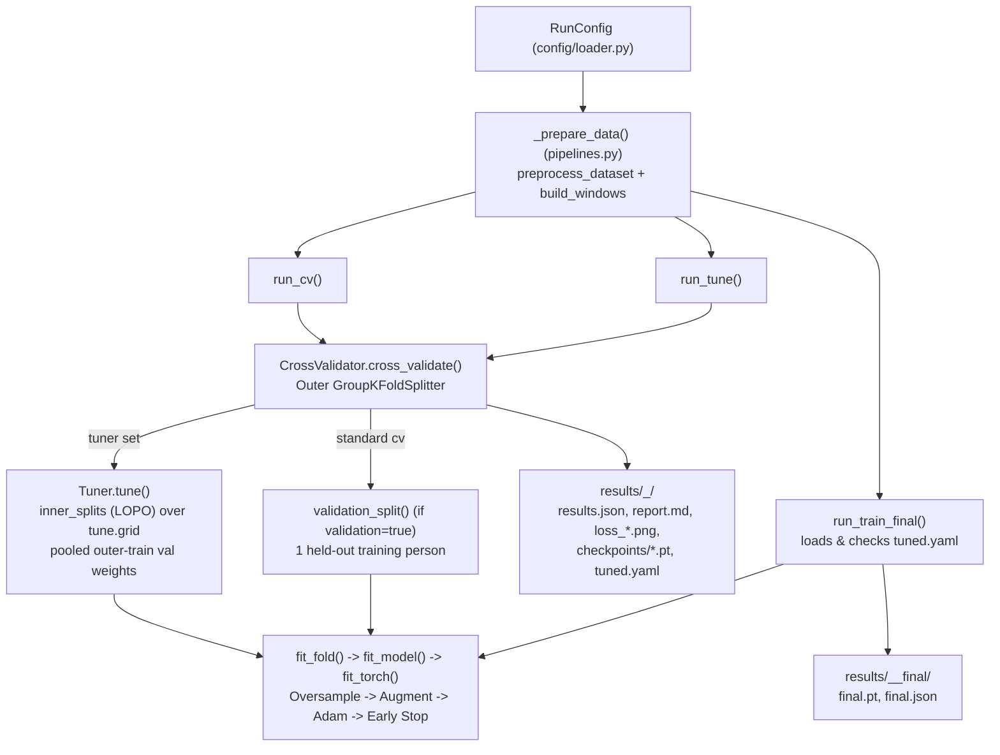

# Training, Tuning, and Pipelines (`src/training/`)

Implements single-model fitting, person-grouped splitting, outer cross-validation, nested leave-one-person-out (LOPO) hyperparameter tuning, and full-dataset final training.


## Modules

| Module                  | Responsibility                                                                                                                            |
| ----------------------- | ----------------------------------------------------------------------------------------------------------------------------------------- |
| `pipelines.py`        | Top-level entry points (`run_cv`, `run_tune`, `run_train_final`) connecting `RunConfig` to baked data and saved results.          |
| `cross_validation.py` | `CrossValidator`: outer person-grouped loop, fold checkpointing, pooled/per-fold/per-person evaluation, and report writing.             |
| `tuning.py`           | `Tuner` (inner LOPO grid search), `best_overall()` (outer-fold winner selection), candidate config overrides, and `tuned.yaml` I/O. |
| `fitting.py`          | Single-model training engine: `History`, `FitConfig`, `build_augment()`, `fit_torch()`, `fit_model()`, and `fit_fold()`.      |
| `splitting.py`        | `GroupKFoldSplitter` (outer folds), `validation_split()` (single held-out training person), and `inner_splits()` (inner LOPO).      |


## Control Flow




## Walkthrough

### 1. Shared Data Preparation (`pipelines.py`)

`_prepare_data(cfg, root)` loads `paths.baked_dir`, runs `preprocess_dataset()`, builds windows for `MODEL_CLASSES[cfg.model.name].input_type`, computes empirical window duration via `window_timing()`, instantiates `RandomOversampler` when `training.oversample_ratio` is set, and captures the full configuration and `WindowCoverage` counts for `results.json`.


### 2. Person-Grouped Splitting (`splitting.py`)

Participants are never split across train, validation, and test sets:

- `GroupKFoldSplitter(k, seed)`: wraps `StratifiedGroupKFold`. With `k=None`, sets `k = len(unique(groups))` (leave-one-person-out). Raises `ValueError` if `k` is outside `[2, n_groups]` or produces an empty test fold.
- `validation_split(train, groups, seed)`: holds out one whole participant from the training fold for early stopping (returns `(train, None)` when fewer than two training participants exist).
- `inner_splits(train, groups)`: generates one `(fit_idx, val_idx)` LOPO pair per participant in `train`, ordered by participant name.


### 3. Single-Model Fitting (`fitting.py`)

`fit_fold()` applies `RandomOversampler` to `fit_idx` only (never to validation or test windows), measures wall-clock training time, and calls `fit_model()`, which dispatches `TorchModel` instances to `fit_torch()` and non-PyTorch models (such as `MajorityClass`) to their `.fit()` method.

Inside `fit_torch()`:

1. Maps string labels to integers `0..K-1`, stores `model.classes_`, builds a fresh `model.net`, and fits training-only input statistics via `model._set_input_stats(x)` (forwarding the scale tensor to `augment.set_input_std()` when augmentation is active).
2. Computes inverse-frequency class weights over $`N`$ samples with $`K`$ present classes and counts $`n_c`$:

   ```math
   w_c = \frac{N}{K \cdot n_c} \quad (n_c > 0), \qquad w_c = 0 \text{ otherwise.}
   ```

   Training cross-entropy uses these weights when `training.class_weights=true`.
3. Trains with `Adam(lr, weight_decay)` on shuffled mini-batches (`batch_size`), running `augment` on each training batch (`PointAugment` uses `apply_with_count()` so `MiniPointNet` keeps the pre-drop point count).
4. When validation data is provided, evaluates class-balanced validation cross-entropy every $`\max(1, \lfloor \text{steps\_per\_epoch} / \text{evals\_per\_epoch} \rfloor)`$ steps:

   ```math
   \mathcal{L}_{\text{val}} = \frac{\sum_i w_{y_i}\,\ell_{\text{CE}}(f(x_i), y_i)}{\sum_i w_{y_i}}
   ```

   With inverse-frequency validation weights, a uniform 50/50 binary predictor scores $`\ln 2 \approx 0.693`$ regardless of class balance. Each strict improvement deep-copies `state_dict` and records `history.best_step`. Training stops after `patience` non-improving evaluations and restores the best weights. Without validation data, training runs for all `epochs` and keeps the final weights.


### 4. Nested LOPO Tuning and Voting (`tuning.py`)

`run_tune()` validates every grid key and value against `hyperparameter_names(cfg)` (all fields of `model.arch`, `model.augment`, and `training` except `validation` and `oversample_ratio`; `baseline` is rejected) before loading data.

Inside each outer fold:

1. `Tuner.tune()` evaluates every candidate in `tune.grid` over `inner_splits(train, groups)`. It passes `val_weight_labels = y[train]` (pooled over all outer-training participants) so every inner validation person is scored on the same loss scale.
2. Each candidate's score is the mean of its kept validation losses across inner folds (lowest wins; ties keep the earlier entry in `tune.grid`). Its epoch count is $`\max(1, \lceil \text{median}(\text{best\_epochs}) \rceil)`$.
3. `CrossValidator` refits the winning candidate on all outer `train` participants (with `val_idx=None`) for that exact epoch count, then evaluates on the untouched outer test participant.

After all outer folds complete, `best_overall()` selects the candidate that won the most outer folds (tie-break: lowest mean validation loss across its wins) with the median of its winning epoch counts, and writes `tune.best_path` (default `results/tuned.yaml`) plus a copy inside the run directory.


### 5. Final Full-Data Training (`run_train_final`)

`run_train_final()` reads `tune.best_path`, verifies that both `model` and `windowing` match the current `RunConfig` (`apply_tuned`), fits one model on all available windows with no validation split, and saves `final.pt` and `final.json` under `results/<timestamp>_<model>_final/`.

For methodological rationale and small-cohort caveats, see [docs/modeling.md](../../docs/modeling.md).


## Usage

```bash
# Person-wise cross-validation
python main.py cv model=rnn training.epochs=20

# Fixed epochs without a validation participant
python main.py cv training.validation=false training.epochs=5

# Nested LOPO tuning (writes results/tuned.yaml)
python main.py tune 'tune.grid=[{model.arch.hidden: 64}, {model.arch.hidden: 128, training.lr: 0.0003}]'

# Train the single deployment model from results/tuned.yaml
python main.py train-final
```


## Extending

- **Exposing a new tunable hyperparameter:** Add the field to `ModelConfig` (`arch` or `augment`) or `TrainingConfig`. `hyperparameter_names()` discovers dataclass fields automatically.
- **Adding a cross-validation metric:** Pass a `metrics` mapping (`(y_true, y_pred, classes) -> float | None`) to `CrossValidator` and update `src/evaluation/report.py` if it should appear in tables.
- **Adding a pipeline mode:** Implement `run_<mode>(cfg, root)` in `src/training/pipelines.py` and register the subcommand in `main.py`.
